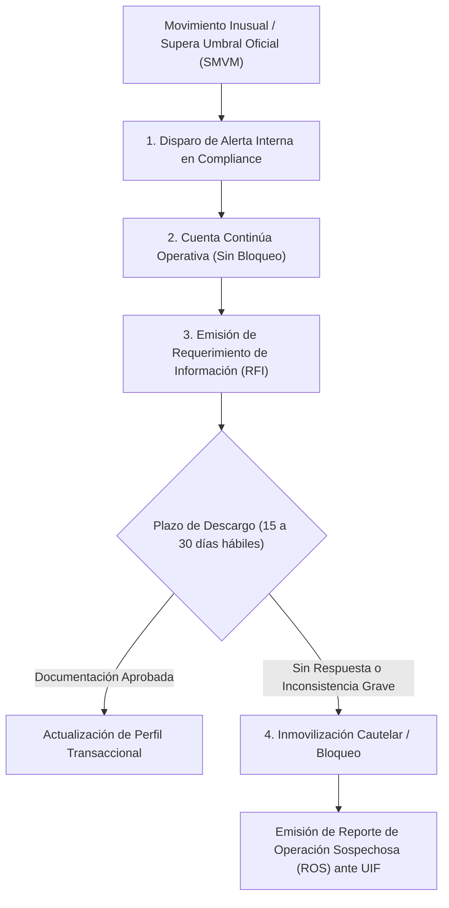

# Régimen Normativo de Prevención de Lavado de Activos (AML/KYC), Monitoreo Transaccional y Criterios Oficiales de Inmovilización de Cuentas

> **Marco Normativo Oficial:**  
> * Ley N° 25.246 (Prevención del Lavado de Activos y Financiación del Terrorismo).  
> * Resolución UIF N° 30/2017 y sus modificatorias reglamentarias (Res. UIF N° 14/2023, Res. UIF N° 51/2024 y Res. UIF N° 78/2025).  
> * Comunicaciones "A" del Banco Central de la República Argentina (BCRA) sobre debida diligencia y cuentas bancarias.  
> * Régimen Informativo de AFIP / ARCA sobre movimientos y saldos.

---

## 1. Principio Fundamental: Enfoque Basado en Riesgo (EBR) y Prohibición de Bloqueos Arbitrarios

Tanto la **Unidad de Información Financiera (UIF)** como el **BCRA** establecen que las entidades financieras deben aplicar un **Enfoque Basado en Riesgo (EBR)**:
* **Trazabilidad y Presunción de Licitud (Res. UIF N° 78/2025):** Las transferencias electrónicas originadas en cuentas del sistema financiero formal (bancos y billeteras reguladas) gozan de una presunción primaria de trazabilidad.
* **Prohibición de "De-risking" o Bloqueos Intempestivos:** La normativa prohíbe congelar o inmovilizar cuentas de manera automática y arbitraria ante simples desvíos temporales de ingresos. Un pico de ingresos (ej. cobro de aguinaldo, indemnización laboral, venta de un vehículo particular o ahorro acumulado) **no constituye por sí mismo un indicio de delito**.
* **Flexibilización de Requisitos Fiscales:** La Res. UIF 78/2025 restringe expresamente a los bancos la exigencia generalizada de declaraciones juradas impositivas como trámite burocrático previo.

---

## 2. Umbrales Regulatorios Oficiales y Perfil Transaccional

El sistema no utiliza múltiplos arbitrarios fijos, sino que adopta los parámetros oficiales vigentes en la legislación argentina:

### A. Unidad de Medida Oficial: Salarios Mínimos, Vitales y Móviles (SMVM)
* **Operaciones en Efectivo (RTE):** El umbral para la identificación fehaciente obligatoria y reporte sistemático de depósitos y extracciones en efectivo está fijado en **40 SMVM** (Res. UIF 78/2025).
* **Perfil Transaccional Prospectivo (*Ex Ante*):** Se estructura considerando:
  1. Nivel de ingresos o facturación demostrable.
  2. Patrimonio y actividad económica principal.
  3. Comportamiento transaccional histórico en la entidad.

### B. Desvíos Significativos vs. Tolerancia Operativa
* Se admite una **banda de tolerancia operativa** para movimientos estacionales o ingresos extraordinarios documentables.
* **Alerta Temprana de Monitoreo:** Se activa únicamente cuando las transacciones acumuladas en el mes exceden sustancialmente el perfil habitual Y superan el umbral objetivo fijado en SMVMs (típicamente a partir de operaciones acumuladas que superen 20 a 40 SMVMs sin antecedentes previos).

---

## 3. Protocolo Oficial y Gradual de Actuación (Paso a Paso)

Ante una operación calificada como *inusual*, el sistema bancario implementa un proceso garantista en 4 etapas:

### Etapa 1: Alerta de Monitoreo Interno (Backoffice)
* El sistema genera una alerta interna para los analistas de Compliance / Prevención de Lavado de Activos.
* **La cuenta permanece 100% activa.** El usuario puede seguir operando con normalidad.

### Etapa 2: Solicitud de Información (*Request for Information - RFI*)
* El banco contacta al cliente vía notificación en el portal web y correo electrónico solicitando documentación de respaldo del origen de fondos:
  * *Boleto de compraventa o escritura* (si vendió una moto, auto o inmueble).
  * *Factura electrónica de venta o contrato de servicios* (si es autónomo/empresa).
  * *Recibo de indemnización, herencia o donación bancarizada*.
* **Plazo Legal Razonable:** Se otorga un período de **15 a 30 días hábiles** para acompañar la documentación.

### Etapa 3: Inmovilización Preventiva (Solo en Casos Extremos)
La inmovilización cautelar o bloqueo (`estado_cuenta = 'SUSPENDIDO_AML'`) **solo procede válidamente cuando**:
1. Venció el plazo de 30 días sin que el cliente presente descargo ni justifique el origen de los fondos.
2. La documentación acompañada resulta manifiestamente apócrifa o fraudulenta.
3. Existe una **orden judicial de embargo/congelamiento dictada por un juez competente**.
4. La persona figura listada en el **RePET** (Registro Público de Personas y Entidades vinculadas a actos de Terrorismo).

### Etapa 4: Reporte de Operación Sospechosa (ROS) y Confidencialidad
* Si tras el análisis de la documentación persiste la sospecha fundada de ilicitud, el Oficial de Cumplimiento eleva un **ROS** confidencial ante la UIF dentro de los plazos reglamentarios.
* **Principio de Confidencialidad (*Tipping-off*):** Por ley (Art. 21 Ley 25.246), el banco tiene **estrictamente prohibido avisarle al cliente que fue objeto de un ROS**.

---

## 4. Política de Bajas y Archivo Legal (Soft Delete)

* **Prohibición de Eliminación Física:** El Art. 21 inc. a) de la Ley N° 25.246 impone el deber de **conservar todos los registros de transacciones y legajos de clientes durante un plazo mínimo de 10 años**.
* **Condición de Cierre:** El cliente solo puede pasar a `estado_cuenta = 'CERRADO'` si no mantiene deuda de créditos exigible ni fondos líquidos pendientes de liquidación.
