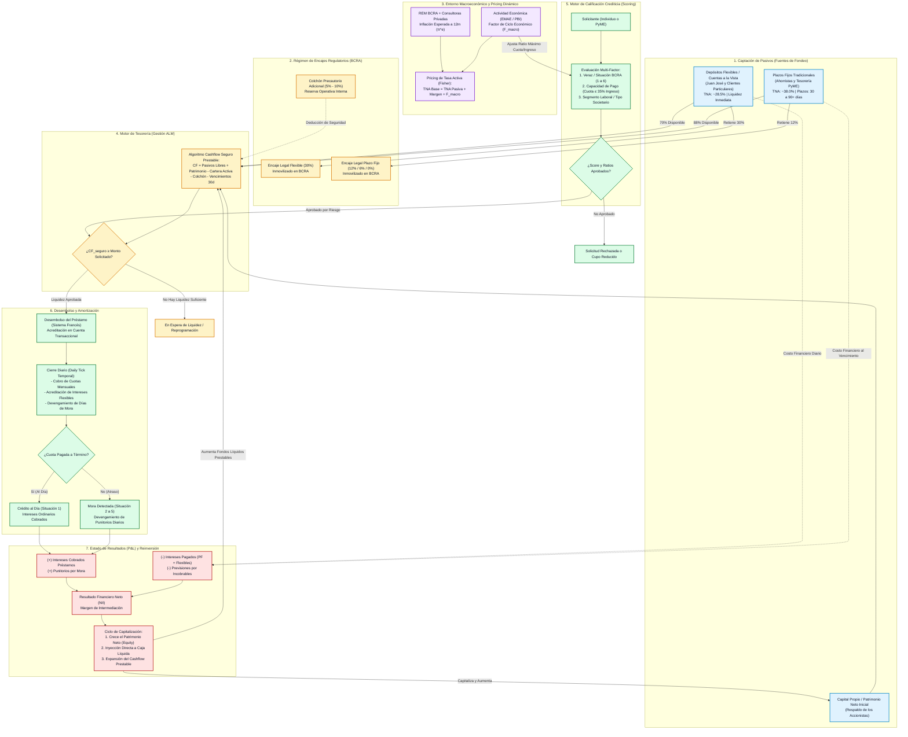

# Funcionamiento Integral del Banco a Nivel Lógica de Negocios

> **Entidad:** Banco del Valle — Scoring Calculator & Lending Engine  
> **Área:** Arquitectura de Negocios, Tesorería Bancaria (ALM), Riesgo Crediticio y Ciclo Financiero  
> **Normativa de Referencia:** Ley de Entidades Financieras N° 21.526, Regulaciones BCRA (Efectivo Mínimo, Clasificación de Deudores), Ley 25.246 (UIF)

---

## 1. Visión Sistémica del Negocio Bancario

Una entidad financiera moderna opera como un **intermediario cuantitativo de liquidez y riesgo**:
1. **Captación de Pasivos:** Atrae liquidez del público (ahorristas particulares) y del sector productivo (empresas) mediante dos instrumentos con perfiles de exigibilidad y costo diferenciados:
   - **Depósitos Flexibles / A la vista:** Cajas de ahorro y cuentas corrientes remuneradas (liquidez inmediata, alto encaje BCRA, costo de fondeo bajo/medio).
   - **Plazos Fijos Tradicionales:** Fondos inmovilizados a 30, 60 o 90+ días (baja exigencia de encaje BCRA, tasa pactada más alta).
2. **Retención Prudencial y Cumplimiento de Encajes (BCRA):** Por cada peso captado, el banco debe inmovilizar una porción legal en reservas líquidas (30% para fondos flexibles, 12% a 0% para plazos fijos).
3. **Cálculo del Cashflow Seguro Prestable:** Algoritmo que determina en tiempo real el capital excedente prestable sin incurrir en descalce de plazos (*maturity mismatch*) ni violar los límites de solvencia.
4. **Colocación de Activos (Préstamos Amortizables):** Otorga financiamiento a personas y empresas evaluadas mediante un motor de Scoring Multi-Factor (ingresos comprobados, estabilidad laboral/societaria, historial Veraz y contexto macroeconómico).
5. **Ciclo de Cobranzas, Mora y Amortización:** Recupero mensual bajo Sistema Francés (cuota fija), monitoreo diario de días de mora y cobro de punitorios.
6. **Margen Financiero Neto (NII) y Ciclo Virtuoso de Capitalización:** El spread entre intereses activos cobrados e intereses pasivos pagados engrosa las utilidades del banco, capitalizándose de inmediato en el **Patrimonio Neto** y expandiendo el **Cashflow Seguro Prestable** para colocar nuevos créditos.

---

## 2. Diagrama Macro del Circuito Financiero del Banco

El siguiente diagrama detalla cómo circula el dinero, la información y las validaciones regulatorias en la entidad:

---

## 3. Desglose Operativo por Capa de Negocio

### A. Captación de Fondos y Costo Financiero Pasivo
* **Cuentas Flexibles / Transaccionales:**
  - El cliente mantiene dinero a la vista en su Caja de Ahorro.
  - El banco remunera ese saldo al **28.5% TNA** (rendimiento devengado diariamente: $\text{Saldo} \times \frac{0.285}{365}$).
  - Al ser fondos retirables en cualquier momento, el BCRA exige inmovilizar el **30% en efectivo mínimo** (`ENC_FLEX`).
* **Plazos Fijos Tradicionales:**
  - El cliente inmoviliza su capital por un plazo contractualmente estipulado (mínimo 30 días, hasta 90+ días) a una tasa fija (ej. **38% TNA**).
  - Al existir certeza temporal del vencimiento, el encaje obligatorio exigido por BCRA es mucho menor (**12% para 30 días**, **6% para 60 días**, **0% a 3% para más de 90 días**).
  - El cliente puede solicitar **cancelación anticipada**: rescata el 100% de su capital original pero resigna la totalidad de los intereses ($0 ganancia).

### B. Gestión de Tesorería y Asset & Liability Management (ALM)
El banco debe prevenir en todo momento el **descalce de plazos**: no puede prestar a 24 meses dinero que los depositantes pueden retirar en 24 horas.
* **Algoritmo de Cashflow Seguro Prestable ($CF_{\text{seguro}}$):**
  $$CF_{\text{seguro}} = \text{Depósitos Flexibles} \times (1 - e_{\text{flex}}) + \text{Plazos Fijos} \times (1 - e_{\text{pf}}) + \text{Patrimonio Neto} - \text{Cartera Activa Prestada} - \text{Colchón} - \text{Compromisos 30d}$$
* **Regla de Negocio:** Ningún préstamo se desembolsa si el monto solicitado excede $CF_{\text{seguro}}$, garantizando que el banco mantenga siempre solvencia absoluta frente a retiros masivos.

### C. Motor de Scoring y Calificación de Solicitantes
* **Individuos:**
  - **Capacidad de Pago:** Cuota del Sistema Francés $\le 35\%$ del ingreso mensual comprobado en BD.
  - **Categoría Laboral:** Empleados públicos y jubilados reciben bonificación de 2 a 3 puntos de tasa y plazos de hasta 60 cuotas. Privados requieren antigüedad $\ge 12$ meses. Monotributistas tienen cupos más conservadores (25% a 30% cuota/ingreso).
  - **Buró Externo (Veraz / Central de Deudores BCRA):** Se consulta situación crediticia (1: Normal hasta 6: Irrecuperable por disposición judicial) y monto de cheques rechazados.
* **Empresas y PyMEs:**
  - **Capacidad de Pago:** Cuota del préstamo $\le 20\%$ de la facturación mensual promedio comprobada.
  - **Tipo Societario:** Las `SAS` y `SRL` de baja antigüedad requieren fianza personal solidaria de los socios fundadores; las `SA` se evalúan con balances auditados; las `COOPERATIVAS` y `MUTUALES` con informe de excedentes y exención de ganancias.

### D. Pricing Macroeconómico de la Tasa de Interés
Para que el banco no sufra pérdidas reales por inflación, se aplica la **Ecuación de Fisher**:
$$\text{TNA Base} \approx \text{Inflación Proyectada 12m (REM + Consultoras)} + \text{Margen de Fondeo}$$
A esta tasa base se le adiciona el spread de riesgo individual según el score del cliente y el factor macroeconómico de actividad ($F_{\text{macro}}$):
* Si el EMAE/PBI está en recesión ($< -1\%$), $F_{\text{macro}} = 1.25 \text{ a } 1.40$, endureciendo el ratio cuota/ingreso (baja al 25%).
* Si la economía se expande ($> +1\%$), $F_{\text{macro}} = 0.85 \text{ a } 0.90$, ampliando la capacidad de colocación.

### E. Cierre Diario y Paso del Tiempo (Daily Tick)
En la simulación acelerada (donde 1 segundo real representa 1 día bancario):
1. Se actualiza la fecha virtual del sistema.
2. Se devengan los rendimientos de las cuentas flexibles a cada titular.
3. Se verifica si es día 1 del mes: se acredita automáticamente el sueldo en las cuentas sueldo (ej. Juan José $3.000.000).
4. Se ejecutan los débitos automáticos de cuotas de préstamos que vencen en la fecha.
5. Para cuotas no cobradas, se incrementa en +1 el contador exacto de `dias_mora` y se liquidan punitorios.
6. Se liquidan o renuevan los plazos fijos que hayan alcanzado su fecha de vencimiento.
7. Se recalculan los encajes legales y se registra el snapshot en `balance_patrimonio_banco`.

### F. Reinversión de Utilidades y Crecimiento Orgánico
Los intereses cobrados por préstamos menos los intereses pagados a depositantes constituyen el **Margen Financiero Neto (NII)**. Este beneficio:
1. No se distribuye inmediatamente: se capitaliza como utilidades retenidas en el **Patrimonio Neto**.
2. Ingresa de manera líquida a la tesorería del banco, aumentando directamente el $CF_{\text{seguro}}$.
3. Habilita una capacidad crediticia ampliada para nuevos préstamos en los ciclos subsiguientes.