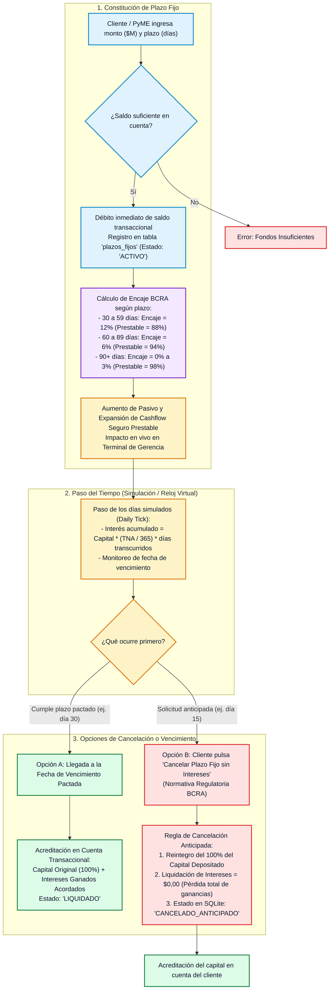
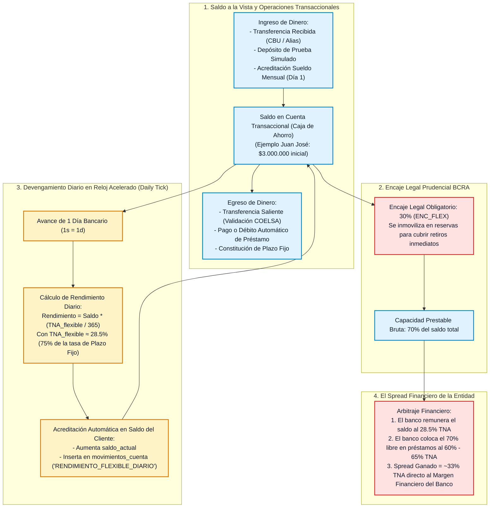

# Manejo de Plazos Fijos, Cuentas Flexibles y Préstamos

> **Entidad:** Banco del Valle — Scoring Calculator & Lending Engine  
> **Área:** Gestión de Pasivos (Ahorro e Inversión), Gestión de Activos (Colocación Crediticia) y Tesorería (ALM)  
> **Normativa de Referencia:** Normas sobre Depósitos e Inversiones a Plazo del BCRA, Amortización Sistema Francés, Efectivo Mínimo BCRA, Central de Deudores del Sistema Financiero (Situaciones 1 a 6)

---

## 1. Visión de Negocio: Intermediación de Pasivos y Activos

El modelo de negocio del banco descansa en la complementariedad entre los productos de **captación de pasivos** y los de **colocación crediticia**:

```
+---------------------------------------------------------------------------------+
|                                 EL BANCO DEL VALLE                              |
|                                                                                 |
|   PASIVOS (Captación)                                 ACTIVOS (Colocación)      |
|   1. Cuentas Flexibles (28.5% TNA)  ----+             1. Préstamos Personales   |
|      - Encaje BCRA: 30%                 |                (60% - 65% TNA)        |
|      - Liquidez a la vista              |                - Familias (hasta 35%  |
|                                         +--> TESORERÍA       del ingreso)       |
|   2. Plazos Fijos (38.0% TNA)       ----+   (ALM)        2. Préstamos PyME      |
|      - Encaje BCRA: 12% a 0%            |   CF_seguro       (55% - 62% TNA)     |
|      - Plazo: 30 a 90+ días             |                - Empresas (hasta 20%  |
|      - Cancelación anticipada           |                    de facturación)    |
+---------------------------------------------------------------------------------+
|   Margen Financiero Neto (Spread ~33% TNA) -> Reinversión en Patrimonio Neto    |
+---------------------------------------------------------------------------------+
```

---

## 2. Plazos Fijos Tradicionales: Constitución, Devengamiento y Cancelación

El Plazo Fijo es el instrumento clásico de captación a término. Otorga previsibilidad financiera a la tesorería al inmovilizar fondos por plazos ciertos, permitiendo encajes BCRA sustancialmente reducidos:



### Reglas Clave de Plazo Fijo:
1. **Encaje Diferencial:** Cuanto más largo es el plazo pactado por el cliente, menor es la reserva que el banco debe inmovilizar en el BCRA, liberando hasta un 98% del dinero para préstamos.
2. **Cancelación Anticipada sin Intereses:** Siguiendo la normativa bancaria argentina para depósitos con opción de cancelación anticipada, el ahorrista puede recuperar su liquidez de inmediato en caso de emergencia, pero **pierde íntegramente la renta devengada**.

---

## 3. Cuentas Flexibles / Transaccionales: Liquidez y Rendimiento Money Market

Las cuentas flexibles (cajas de ahorro remuneradas) permiten al cliente operar con transferencias, depósitos y retiros inmediatos, mientras que el saldo devenga un rendimiento pasivo diario:



### Reglas Clave de Cuentas Flexibles:
* **Fórmula de Tasa Flexible:** $\text{TNA}_{\text{flexible}} \approx \text{TNA}_{\text{plazo\_fijo}} \times 0.75 = 38\% \times 0.75 = 28.5\%$.
* **Modelo Money Market:** A diferencia de una cuenta corriente tradicional que no remunera saldo, el banco acredita rendimiento diario sin inmovilizar el dinero del usuario.
* **Cuentas Sueldo:** Si `es_cuenta_sueldo = 1`, cada día 1 del mes el motor de simulación acredita automáticamente el salario acordado (ej. $3.000.000 para Juan José).

---

## 4. Préstamos: Solicitud, Scoring, Desembolso, Amortización y Mora

El módulo de préstamos gobierna la colocación del activo del banco. Integra el cálculo de cuotas por **Sistema Francés**, la evaluación de riesgo multi-factor, la validación de liquidez en tesorería y el seguimiento exacto de atrasos:

```mermaid
flowchart TD
    classDef default fill:#FFFFFF,stroke:#334155,stroke-width:2px,color:#0F172A;
    classDef input fill:#E0F2FE,stroke:#0284C7,stroke-width:2px,color:#0F172A;
    classDef scoring fill:#FEF3C7,stroke:#D97706,stroke-width:2px,color:#0F172A;
    classDef tesoreria fill:#F3E8FF,stroke:#7E22CE,stroke-width:2px,color:#0F172A;
    classDef frances fill:#DCFCE7,stroke:#15803D,stroke-width:2px,color:#0F172A;
    classDef mora fill:#FEE2E2,stroke:#DC2626,stroke-width:2px,color:#0F172A;

    subgraph SIMULADOR["1. Solicitud y Parametrización"]
        INPUT_CREDITO["Solicitante ingresa DNI o CUIT + Monto ($M) + Cuotas (n)"]:::input
        TIPO_SUJETO{"¿Tipo de Solicitante?"}:::input
    end

    subgraph MOTOR_SCORING["2. Motor Multi-Factor de Calificación de Riesgo"]
        SCORE_PERSONA["Evaluación Individuos:<br/>- Categoría Laboral (Público, Privado, Monotributista)<br/>- Veraz / BCRA: Situaciones 1 a 6 y cheques impagos<br/>- Ratio RME: Cuota ≤ 35% del sueldo neto"]:::scoring
        SCORE_EMPRESA["Evaluación PyME / Empresas:<br/>- Tipo societario (SA, SRL, SAS, Coop, Mutual)<br/>- Facturación comprobada: Cuota ≤ 20% mensual<br/>- Fianza solidaria de socios (obligatoria para SAS nuevas)"]:::scoring
        
        AJUSTE_MACRO["Ajuste de Ciclo Macroeconómico (EMAE / PBI):<br/>- Si hay recesión (PBI menor a -1%): RME baja de 35% a 25% del ingreso<br/>- Recargo de spread por riesgo macro"]:::scoring
        DECISION_SCORING{"¿Aprueba Scoring de Riesgo?"}:::scoring
    end

    subgraph TESORERIA_CHECK["3. Validación de Liquidez de Tesorería (ALM)"]
        CHECK_CF["Consulta Cashflow Seguro Prestable (CF_seguro) en BD"]:::tesoreria
        HAY_LIQUIDEZ{"¿Monto Solicitado ≤ CF_seguro?"}:::tesoreria
        BLOQUEO_LIQ["Rechazo Preventivo de Liquidez:<br/>'El cliente aprueba por riesgo, pero el banco no dispone de liquidez prestable libre para no violar encajes'"]:::mora
    end

    subgraph DESEMBOLSO_FRANCES["4. Desembolso y Sistema Francés"]
        CALC_FRANCES["Generación de Cronograma de Amortización (Sistema Francés):<br/>- Cuota fija mensual constante<br/>- Interés decreciente: I_t = Saldo_t * (TNA / 12)<br/>- Capital creciente: Amort_t = Cuota - I_t"]:::frances
        ALTA_PRESTAMO["Alta en SQLite: Tabla 'prestamos' (Estado: 'ACTIVO')<br/>Generación de registros en tabla 'cuotas'<br/>Acreditación del capital en cuenta del cliente"]:::frances
    end

    subgraph COBRANZA_MORA["5. Ciclo de Cobranza Diaria y Mora Exacta (Daily Tick)"]
        VENCE_CUOTA["Llega fecha de vencimiento de la cuota mensual"]:::frances
        INTENTO_DEBITO{"¿Saldo suficiente en cuenta?"}:::frances
        
        PAGO_EXITOSO["Pago Exitoso:<br/>- Débito de cuota<br/>- dias_mora = 0<br/>- Intereses al P&L del banco<br/>- Reducción del saldo deudor"]:::frances
        
        MORA_ACTIVA["Cuota Impaga:<br/>- Contador exacto: dias_mora = dias_mora + 1<br/>- Devengamiento de punitorios diarios<br/>- Clasificación BCRA según atraso:<br/>  * 1 a 30 días: Mora Leve (Sit. 2)<br/>  * 31 a 90 días: Mora Media (Sit. 3)<br/>  * más de 90 días: Mora Severa / Incobrable (Sit. 4-5)"]:::mora
    end

    INPUT_CREDITO --> TIPO_SUJETO
    TIPO_SUJETO -- "Individuo" --> SCORE_PERSONA
    TIPO_SUJETO -- "Empresa" --> SCORE_EMPRESA
    SCORE_PERSONA --> AJUSTE_MACRO
    SCORE_EMPRESA --> AJUSTE_MACRO
    AJUSTE_MACRO --> DECISION_SCORING
    DECISION_SCORING -- "Rechazado" --> RECHAZO_SCORE["Crédito Denegado por Exceso de Riesgo"]:::mora
    DECISION_SCORING -- "Aprobado" --> CHECK_CF
    CHECK_CF --> HAY_LIQUIDEZ
    HAY_LIQUIDEZ -- "No hay liquidez" --> BLOQUEO_LIQ
    HAY_LIQUIDEZ -- "Liquidez verificada" --> CALC_FRANCES
    CALC_FRANCES --> ALTA_PRESTAMO
    ALTA_PRESTAMO --> VENCE_CUOTA
    VENCE_CUOTA --> INTENTO_DEBITO
    INTENTO_DEBITO -- "Saldo disponible" --> PAGO_EXITOSO
    INTENTO_DEBITO -- "Saldo insuficiente" --> MORA_ACTIVA
    MORA_ACTIVA -.->|Próximo tick si sigue sin pagar| MORA_ACTIVA
    MORA_ACTIVA -.->|Si el cliente deposita y paga| PAGO_EXITOSO
```



---

## 5. Tabla de Amortización Francesa: Estructura Financiera

En el **Sistema Francés**, la cuota mensual ($C$) es constante a lo largo de todo el crédito:

$$C = P \times \frac{i \times (1 + i)^n}{(1 + i)^n - 1}$$

Donde:
* $P$ = Capital inicial prestado.
* $i$ = Tasa de interés periódica mensual ($i = \frac{\text{TNA}}{12}$).
* $n$ = Cantidad total de cuotas mensuales.

### Comportamiento de las Componentes:
1. **Interés Mensual ($I_t$):** Disminuye en cada período, ya que se calcula sobre el capital residual pendiente:
   $$I_t = \text{Saldo Deudor}_{t-1} \times i$$
2. **Amortización de Capital ($A_t$):** Aumenta mes a mes para compensar la caída del interés:
   $$A_t = C - I_t$$
3. **Control de Consistencia:** La suma de las amortizaciones de capital de todas las cuotas es **estrictamente idéntica al monto original prestado** ($\sum_{t=1}^n A_t = P$).

---

## 6. Sinergia Integral: El Circuito de Liquidez y Descalce (ALM)

El siguiente gráfico consolida cómo el banco equilibra diariamente sus pasivos de corto plazo con sus activos de largo plazo:

```
+---------------------------------------------------------------------------------------------------+
|                                  MATRIZ DE CALCE FINANCIERO (ALM)                                 |
+-----------------------------------+-----------------------------------+---------------------------+
| INSTRUMENTO                       | EXIGIBILIDAD / PLAZO              | ENCAJE BCRA               |
+-----------------------------------+-----------------------------------+---------------------------+
| Cuentas Flexibles (A la vista)    | Inmediata (0 a 24 horas)          | 30.0% (Inmovilizado)      |
| Plazos Fijos 30 días              | Corto plazo (30 días)             | 12.0%                     |
| Plazos Fijos 60 días              | Corto plazo (60 días)             |  6.0%                     |
| Plazos Fijos 90+ días             | Mediano plazo (90+ días)          |  0.0% a 3.0%              |
| Préstamos Personales Otorgados    | Activo a Mediano Plazo (12-24m)   | Genera cobro de cuotas    |
| Préstamos PyME Otorgados          | Activo Productivo (24-48m)        | Genera cobro de cuotas    |
+-----------------------------------+-----------------------------------+---------------------------+
| REGLA OPERATIVA DE TESORERÍA:                                                                     |
| La porción no encajada de los depósitos (70% flexibles + 88% PF) sumada al Capital Propio         |
| debe superar holgadamente la cartera de préstamos activa más los vencimientos a 30 días.         |
| De existir déficit de caja, el sistema detiene inmediatamente los desembolsos de créditos.        |
+---------------------------------------------------------------------------------------------------+
```