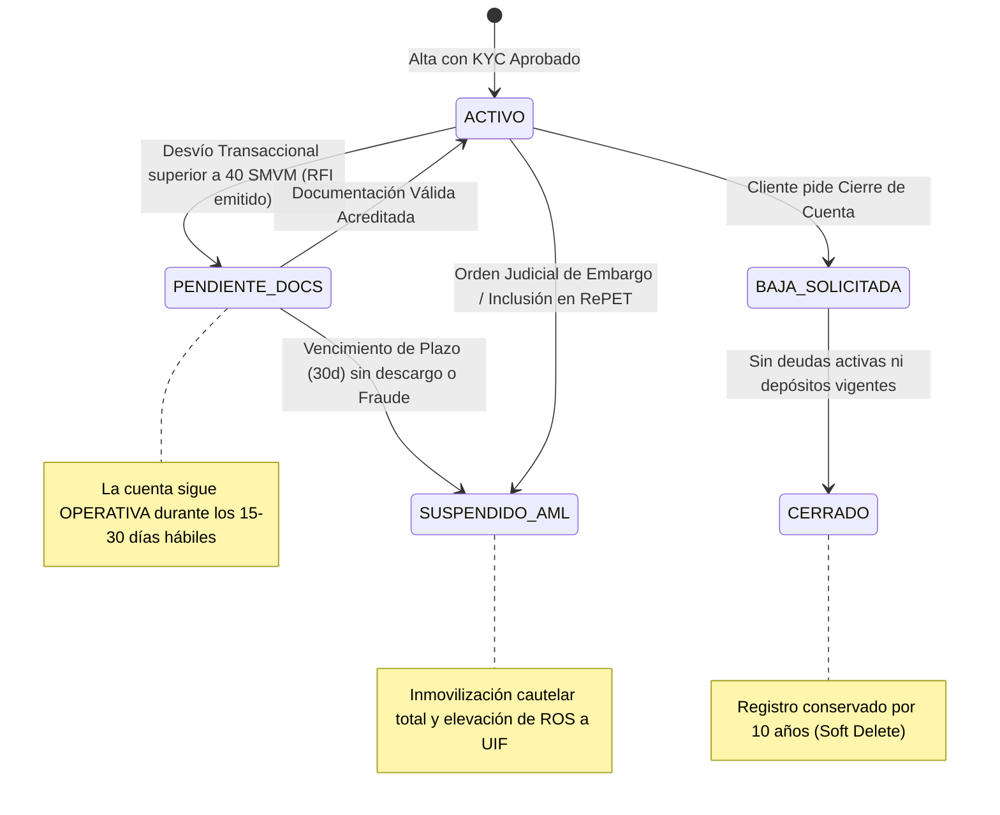

# Manejo de Usuarios, Empresas, Compliance AML y Gestión de Bloqueos

> **Entidad:** Banco del Valle — Scoring Calculator & Lending Engine  
> **Área:** Prevención de Lavado de Activos y Financiamiento del Terrorismo (PLA/FT), Onboarding, Gestión de Riesgo de Cumplimiento y Ciclo de Vida de Cuentas  
> **Marco Normativo:** Ley N° 25.246, Resoluciones UIF N° 30/2017, N° 14/2023, N° 51/2024 y N° 78/2025, Comunicaciones "A" BCRA, RePET y Registro de Juicios Universales

---

## 1. Principios Rectores: Enfoque Basado en Riesgo (EBR) y Debido Proceso

Conforme a la **Resolución UIF N° 78/2025** y las directrices del BCRA, el sistema bancario implementa una política estricta contra el *"de-risking"* o bloqueo intempestivo y arbitrario de cuentas:
* **Presunción de Licitud Bancarizada:** Los fondos provenientes de cuentas del sistema financiero formal (bancos y PSP regulados por BCRA) gozan de una presunción primaria de trazabilidad.
* **Prohibición de Bloqueos Automáticos Intempestivos:** Un ingreso inusual (ej. cobro de indemnización laboral, venta de un vehículo particular, donación o cobro de aguinaldo) **nunca debe provocar el congelamiento automático de los fondos del cliente**.
* **Unidad de Medida Oficial:** Todos los umbrales de monitoreo se expresan en **Salarios Mínimos, Vitales y Móviles (SMVM)** para preservar su vigencia frente a la inflación. El umbral para identificación reforzada de operaciones en efectivo (RTE) se sitúa en **40 SMVM**.
* **Plazo Legal Razonable de Descargo:** Toda solicitud de justificación de fondos (*Request for Information - RFI*) concede al cliente un plazo legal garantista de **15 a 30 días hábiles** para aportar la documentación respaldatoria.

---

## 2. Diagrama Integral: Onboarding, Monitoreo AML y Protocolo Gradual de Bloqueo

El siguiente diagrama modela el ciclo de vida de clientes (individuos y corporativos), el monitoreo transaccional en tiempo real y el procedimiento regulatorio ante alertas:

```mermaid
flowchart TD
    classDef default fill:#FFFFFF,stroke:#334155,stroke-width:2px,color:#0F172A;
    classDef onboarding fill:#E0F2FE,stroke:#0284C7,stroke-width:2px,color:#0F172A;
    classDef monitor fill:#FEF3C7,stroke:#D97706,stroke-width:2px,color:#0F172A;
    classDef alert fill:#FEE2E2,stroke:#DC2626,stroke-width:2px,color:#0F172A;
    classDef legal fill:#F3E8FF,stroke:#7E22CE,stroke-width:2px,color:#0F172A;
    classDef softdel fill:#DCFCE7,stroke:#15803D,stroke-width:2px,color:#0F172A;

    subgraph ONBOARDING["1. Onboarding y Segmentación de Clientes"]
        SOLICITUD["Solicitud de Alta de Cuenta"]:::onboarding
        TIPO_CLIENTE{"¿Tipo de Cliente?"}:::onboarding
        
        INDIVIDUO["Persona Humana (Individuo):<br/>- DNI / CUIL validado<br/>- Categoría Laboral (Público, Privado, Monotributo, Jubilado)<br/>- Ingresos Netos Comprobados ($)<br/>- Cuenta Sueldo (Opcional, ej. Juan José)"]:::onboarding
        EMPRESA["Persona Jurídica (Empresa / PyME):<br/>- CUIT validado en AFIP/ARCA<br/>- Tipo Societario (SA, SRL, SAS, Coop, Mutual, Fundación)<br/>- Facturación Anual Demostrable<br/>- Fianza Solidaria Socios (si es SAS/SRL nueva)<br/>- Exención Impositiva Verificada"]:::onboarding

        LISTAS_CONTROL{"¿Coincidencia en Listas Restrictivas?<br/>(RePET Terrorismo / Oficio Judicial)"}:::legal
        PERFIL_EX_ANTE["Definición de Perfil Transaccional Ex-Ante:<br/>- Capacidad Operativa Mensual (en SMVMs)<br/>- Estado Cuenta: 'ACTIVO'"]:::onboarding
    end

    subgraph OPERATORIA["2. Operatoria Transaccional Diaria"]
        TRANSACCION["Movimiento de Fondos:<br/>- Transferencia Entrante / Saliente<br/>- Depósito de Efectivo<br/>- Rendimiento Flexible o Liquidación PF"]:::monitor
        EVAL_TRANS{"Evaluación de Reglas AML:<br/>1. ¿Supera umbral objetivo oficial (40 SMVM)?<br/>2. ¿Se desvía significativamente del perfil histórico?<br/>3. ¿Fraccionamiento de depósitos (pitufeo)?"}:::monitor
        OPERACION_NORMAL["Transacción Aprobada:<br/>- Sin banderas rojas<br/>- Saldo acreditado normalmente"]:::monitor
    end

    subgraph PROTOCOLO["3. Protocolo Oficial y Gradual de Compliance (UIF / BCRA)"]
        ALERTA_COMPLIANCE["Etapa 1: Alerta Interna de Monitoreo<br/>- Bandera 'alerta_aml = 1' en auditoría interna<br/>- ATENCIÓN: La cuenta permanece 100% OPERATIVA"]:::alert
        RFI_EMISION["Etapa 2: Solicitud de Información (RFI)<br/>- Notificación vía Home Banking y Correo<br/>- Se solicita origen de fondos (Factura, Boleto, etc.)<br/>- Estado: 'PENDIENTE_DOCS'<br/>- Plazo Legal: 15 a 30 DÍAS HÁBILES"]:::alert
        
        DESCARGO{"¿Respuesta del Cliente en Plazo?"}:::alert
        DOCS_APROBADAS["Documentación Válida Presentada:<br/>(Escritura, Boleto Compraventa, Factura, Recibo Sueldo)"]:::onboarding
        ACTUALIZAR_PERFIL["Actualización de Perfil Transaccional:<br/>- Se amplía el límite operativo del cliente<br/>- Estado vuelve a 'ACTIVO'<br/>- Cierre de Alerta sin sanción"]:::onboarding

        DOCS_RECHAZADAS["Incumplimiento Grave:<br/>- Vencimiento de los 30 días sin descargo<br/>- Documentación manifiestamente apócrifa<br/>- Orden Judicial de Embargo / Inhibición"]:::alert
        
        BLOQUEO_CAUTELAR["Etapa 3: Inmovilización Cautelar de Cuenta<br/>- Estado: 'SUSPENDIDO_AML'<br/>- Bloqueo preventivo de extracciones y transferencias<br/>- Los fondos permanecen bajo custodia judicial"]:::alert
        
        ROS_UIF["Etapa 4: Reporte de Operación Sospechosa (ROS)<br/>- Oficial de Cumplimiento eleva reporte digital a UIF<br/>- REGLA DE ORO: Confidencialidad Absoluta (Anti-Tipping-Off)<br/>- PROHIBIDO notificar al cliente sobre el ROS"]:::legal
    end

    subgraph CICLO_VIDA["4. Solicitud de Baja y Archivo Legal (Soft Delete)"]
        PETICION_BAJA["Cliente Solicita Baja de Cuenta"]:::softdel
        VALIDA_DEUDAS{"¿Mantiene deudas en préstamos<br/>o depósitos activos pendientes?"}:::softdel
        RECHAZO_BAJA["Baja Denegada Temporalmente:<br/>'Debe liquidar préstamos y retirar saldo previo a la baja'"]:::softdel
        BAJA_ACEPTADA["Estado Cuenta: 'BAJA_SOLICITADA' -> 'CERRADO'"]:::softdel
        SOFT_DELETE["Retención Obligatoria por 10 Años (Art. 21 Ley 25.246):<br/>- PROHIBICIÓN DE 'DELETE' FÍSICO EN BD<br/>- Registros y movimientos preservados para auditoría"]:::softdel
    end

    %% Conexiones Onboarding
    SOLICITUD --> TIPO_CLIENTE
    TIPO_CLIENTE -- "Persona Humana" --> INDIVIDUO
    TIPO_CLIENTE -- "Empresa / PyME" --> EMPRESA
    INDIVIDUO --> LISTAS_CONTROL
    EMPRESA --> LISTAS_CONTROL
    LISTAS_CONTROL -- "Sí (Terrorismo / Oficio)" --> BLOQUEO_CAUTELAR
    LISTAS_CONTROL -- "No (Limpio)" --> PERFIL_EX_ANTE

    %% Conexiones Operatoria
    PERFIL_EX_ANTE --> TRANSACCION
    TRANSACCION --> EVAL_TRANS
    EVAL_TRANS -- "Dentro del Perfil" --> OPERACION_NORMAL
    EVAL_TRANS -- "Movimiento Inusual" --> ALERTA_COMPLIANCE

    %% Conexiones Protocolo Gradual
    ALERTA_COMPLIANCE --> RFI_EMISION
    RFI_EMISION --> DESCARGO
    DESCARGO -- "Documentos Respaldan Operación" --> DOCS_APROBADAS
    DOCS_APROBADAS --> ACTUALIZAR_PERFIL
    ACTUALIZAR_PERFIL --> OPERACION_NORMAL
    DESCARGO -- "Sin Respuesta o Fraude" --> DOCS_RECHAZADAS
    DOCS_RECHAZADAS --> BLOQUEO_CAUTELAR
    BLOQUEO_CAUTELAR --> ROS_UIF

    %% Conexiones Ciclo de Vida
    OPERACION_NORMAL -.-> PETICION_BAJA
    PETICION_BAJA --> VALIDA_DEUDAS
    VALIDA_DEUDAS -- "Tiene Crédito Impago o Saldo" --> RECHAZO_BAJA
    VALIDA_DEUDAS -- "Saldo $0 y Sin Deudas" --> BAJA_ACEPTADA
    BAJA_ACEPTADA --> SOFT_DELETE
```

---

## 3. Matriz Comparativa: Segmentación de Usuarios vs. Empresas

La diligencia debida (KYC) varía según la naturaleza jurídica del cliente:

| Criterio | Individuos / Personas Humanas | Empresas / Personas Jurídicas |
| :--- | :--- | :--- |
| **Identificador Fiscal** | DNI / CUIL (ej. `20-35123456-7`) | CUIT (ej. `30-71234567-9`) |
| **Documentación Base** | DNI frente y dorso, constancia CUIL, comprobante de domicilio. | Contrato Social / Estatuto inscripto, Acta de designación de autoridades, Poderes vigentes. |
| **Evaluación de Fondos** | Recibo de sueldo, comprobante previsional o constancia de inscripción AFIP (Monotributo/Autónomos). | Últimos balances contables auditados, certificaciones contables de ingresos o declaraciones juradas de IVA. |
| **Reglas Particulares por Tipo** | - **Empleados Públicos/Jubilados:** Alta estabilidad, bajo riesgo AML. - **Autónomos:** Perfil dinámico sujeto a estacionalidad. | - **SA / SAS / SRL:** Si la SAS/SRL tiene $< 2$ años, requiere **fianza solidaria de los socios**. - **Cooperativas / Mutuales:** Exentas de Ganancias, foco en balances sociales. - **Fundaciones / ONGs:** Justificación obligatoria de donantes relevantes. |
| **Perfil Transaccional Inicial** | 1 a 3 veces el ingreso mensual comprobado. | Facturación mensual promedio declarada en balances. |

---

## 4. El Protocolo Oficial de Bloqueo en 4 Etapas

Para dar estricto cumplimiento al marco UIF y jurisprudencia bancaria, el sistema implementa una **escalera de actuación garantista**:

### Reglas Críticas del Procedimiento:
1. **Etapa 1 — Alerta Interna Silenciosa (`alerta_aml = 1`):**  
   Se genera en la tabla `movimientos_cuenta` un marcador de auditoría. El usuario puede seguir retirando dinero, depositando o pagando con normalidad.
2. **Etapa 2 — Requerimiento Formal de Información (RFI):**  
   Se otorga un plazo garantista de **15 a 30 días hábiles**. Ejemplos de descargo aceptable:
   - *Venta de Inmueble o Rodado:* Copia certificada del boleto de compraventa o formulario 08 inscripto.
   - *Actividad Profesional / PyME:* Factura electrónica ARCA emitida por el cobro del servicio o venta de mercadería.
   - *Herencia o Donación:* Testimonio judicial de declaratoria de herederos o escritura de donación.
3. **Etapa 3 — Supuestos Taxativos de Inmovilización (`SUSPENDIDO_AML`):**  
   El bloqueo preventivo **únicamente** se aplica en los siguientes 4 casos taxativos:
   - Vencimiento improrrogable del plazo legal de 30 días hábiles sin ningún tipo de comunicación por parte del titular.
   - Presentación de instrumentos comprobadamente falsificados o apócrifos.
   - Notificación de **Oficio Judicial** dictado por juez competente (embargo preventivo o inhibición de bienes).
   - Coincidencia confirmada con el **Registro Público de Personas y Entidades Vinculadas a Actos de Terrorismo (RePET)**.
4. **Etapa 4 — Reporte de Operación Sospechosa (ROS) y Anti-Tipping-Off:**  
   El Oficial de Cumplimiento envía el reporte digitalmente a la UIF. **Bajo apercibimiento de sanciones penales (Art. 21 Ley 25.246)**, el personal del banco tiene prohibido revelar al cliente o a terceros la existencia de un ROS.

---

## 5. Política de Conservación de Datos y Soft Delete (10 Años)

* **Prohibición Expresa de `DELETE` Físico:** En la base de datos `banco_scoring.db` nunca se ejecutan sentencias de borrado físico (`DELETE FROM personas`, `DELETE FROM empresas`, `DELETE FROM cuentas_transaccionales`).
* **Justificación Legal:** El Art. 21 inc. a) de la Ley N° 25.246 impone la obligación de conservar todos los legajos de identificación y el detalle de cada transferencia o depósito por un **mínimo de 10 años** a disposición de la UIF y el Poder Judicial.
* **Flujo de Baja Segura:**
  1. El cliente pulsa "Solicitar Cierre de Cuenta" en el Home Banking.
  2. El sistema valida dos condiciones excluyentes:
     - $\sum \text{Saldo Deudor de Préstamos Activos} = 0$.
     - $\text{Saldo Disponible en Cuenta Transaccional} = 0$ (o transferido a cuenta externa) y $\sin\text{ Plazos Fijos en Curso}$.
  3. Si cumple ambas: `estado_cuenta` pasa a `'CERRADO'` y se inhabilitan las credenciales en `usuarios_credenciales`. Los registros históricos quedan permanentemente accesibles para fines de auditoría.