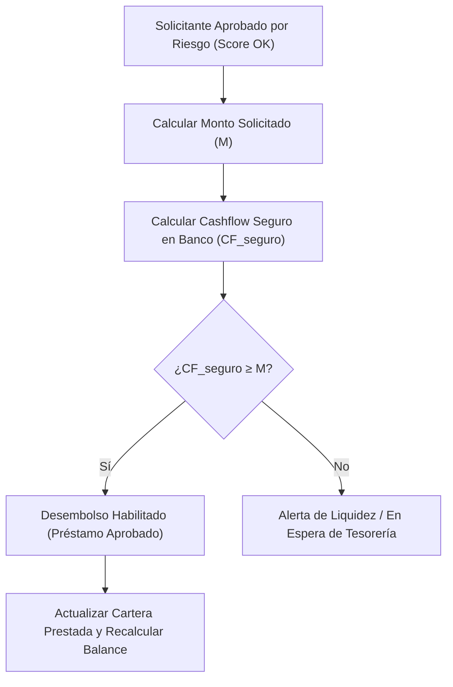

# Multiplicador Bancario y Algoritmo de Cashflow Seguro Prestable

## 1. Fundamentos Teóricos: El Multiplicador del Dinero

En un sistema bancario de **reserva fraccionaria**, los bancos no conservan la totalidad de los depósitos en caja fuerte; prestan una porción y retienen únicamente el porcentaje fijado por el encaje legal ($e$) y sus reservas de liquidez precautorias.

### La Fórmula General del Multiplicador Monetario ($m$):
$$m = \frac{1 + c}{c + e}$$

Donde:
* $c = \frac{\text{Billetes en poder del público}}{\text{Depósitos Totales}}$ (Coeficiente de preferencia por el circulante).
* $e = \frac{\text{Reservas Bancarias / Encajes}}{\text{Depósitos Totales}}$ (Tasa de encaje o reservas de los bancos).

### Interpretación Práctica para una Entidad Individual:
A nivel macroeconómico, cada peso depositado se multiplica varias veces en la economía. Pero a nivel de **nuestra entidad financiera**, la regla de oro es:
$$\text{Fondos Prestables Brutos} = \text{Depósito Captado} \times (1 - e)$$
El banco **nunca debe prestar el 100% de los depósitos**, pues violaría la normativa de Efectivo Mínimo del BCRA y entraría en default de encajes.

---

## 2. El Problema del Descalce de Plazos (Maturity Mismatch)

Una financiera o banco captura pasivos y coloca activos con naturalezas temporales distintas:
* **Pasivos (Depósitos):** Plazos Fijos a 30 o 60 días, y depósitos flexibles con retiro inmediato (días u horas).
* **Activos (Préstamos):** Créditos personales amortizables en 12, 24 o 36 meses.

> [!WARNING]
> Si el banco presta el total de los fondos disponibles sin considerar los vencimientos de los Plazos Fijos o la volatilidad de las cuentas flexibles, sufrirá una crisis de liquidez cuando los ahorristas soliciten sus retiros.

---

## 3. Modelo Matemático: Cálculo del Cashflow Seguro Prestable

El sistema debe ejecutar una validación en tiempo real antes de aprobar y desembolsar un nuevo préstamo.

### Fórmula del Cashflow Seguro Disponible ($CF_{\text{seguro}}$):

$$CF_{\text{seguro}} = \sum (\text{Depósitos Flexibles} \times (1 - e_{\text{flex}})) + \sum (\text{Plazos Fijos} \times (1 - e_{\text{pf}})) + \text{Capital Propio} - \text{Cartera Activa Prestada} - \text{Colchón Precautorio} - \text{Compromisos a Vencer (30d)}$$

### Desglose de Variables:
1. **Depósitos Flexibles Ajustados:** Saldo total de cajas y cuentas remuneradas menos su encaje legal ($e_{\text{flex}} \approx 30\%$).
2. **Plazos Fijos Ajustados:** Saldo total en PF menos su encaje ($e_{\text{pf}} \approx 12\%$).
3. **Capital Propio / Patrimonio:** Fondos propios líquidos de la entidad.
4. **Cartera Activa Prestada:** Capital total colocado en la calle pendiente de cobro.
5. **Colchón Precautorio de Tesorería ($\alpha$):** Porcentaje adicional de seguridad (típicamente entre 5% y 10% del total de depósitos) para contingencias operativas.
6. **Compromisos a Vencer en 30 días:** Intereses devengados de plazos fijos prontos a liquidarse que no han sido marcados para renovación automática.

---

## 4. Algoritmo de Aprobación de Liquidez de Tesorería

Cuando un solicitante aprueba el filtro de scoring de riesgo personal, el sistema consulta el módulo de tesorería:

### Reglas de Decisión:
* **Si $M \le CF_{\text{seguro}}$:** El préstamo puede ser desembolsado de inmediato sin alterar la solvencia ni los encajes del BCRA.
* **Si $M > CF_{\text{seguro}}$:** Aunque el cliente sea confiable y tenga excelente score, el banco no puede prestarle en ese momento porque violaría las normas de encaje o pondría en riesgo la devolución de los depósitos.
