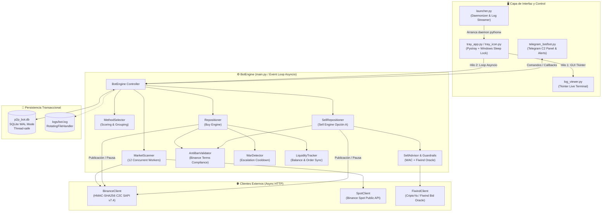

# ⚡ Binance P2P Algorithmic Market Making & Arbitrage Engine (ARS)

[](https://www.python.org/)
[]()
[]()
[]()
[]()
[]()
[-success.svg)]()

> **Sistema institucional de Market Making, gestión algorítmica de liquidez y arbitraje multiactivo para el mercado P2P de Binance (Pesos Argentinos - ARS).** Diseñado para operar con alta concurrencia, protección estricta contra baneos de la exchange, oráculo de precios, evasión de guerras de precios destructivas y control remoto bidireccional mediante interfaz Telegram y bandeja de sistema de Windows.

> [!IMPORTANT]
> **Naturaleza de la Interfaz & Ejecución:** Este sistema es un motor de **alta concurrencia en línea de comandos (CLI)** y **bandeja del sistema Windows (System Tray)**. **No abre navegador web**, garantizando mínima latencia y bajo consumo de recursos en entornos headless o servidores dedicados.
>
> 🚀 **Lanzador 1-Clic para Windows:** Incluye el script interactivo [`INICIAR_MODO_DEMO.bat`](INICIAR_MODO_DEMO.bat) para seleccionar entre Modo Demo Zero-API, Bot CLI o Bandeja de Sistema, y [`INICIAR_BOT_ORIGINAL.bat`](INICIAR_BOT_ORIGINAL.bat) para el arranque directo en producción.
> 
> 🔒 **Modo Demo & Seguridad Operativa (Zero-API Sandbox):**
> - **Sin exposición de claves privadas:** Por estrictas políticas de seguridad y protección de capital, no se incluyen claves reales de Binance API ni tokens de Telegram (`.env.example` provisto).
> - **Propiedad Intelectual y Ventaja Competitiva:** Los algoritmos de arbitraje y reposicionamiento en el podio P2P forman parte de un sistema propietario de alta rentabilidad; la versión pública está desacoplada del capital productivo.
> - **Sandbox 100% Funcional:** La Opción 1 del lanzador ejecuta una simulación en memoria de libros P2P, Repositioner, Escalera de Ventas y Oráculo Fiwind sin requerir credenciales ni fondos reales.

---

## 📑 Tabla de Contenidos

- [Visión General & Propósito](#-visión-general--propósito)
- [Arquitectura del Sistema](#-arquitectura-del-sistema)
- [Módulos y Capacidades Clave](#-módulos-y-capacidades-clave)
  - [1. Motor de Escaneo Concurrente & Rate Limiting](#1-motor-de-escaneo-concurrente--rate-limiting)
  - [2. Reposicionamiento Dinámico & Algoritmos de Pricing](#2-reposicionamiento-dinámico--algoritmos-de-pricing)
  - [3. Gestión de Riesgo, WAC & Arbitraje Fiwind](#3-gestión-de-riesgo-wac--arbitraje-fiwind)
  - [4. Auditoría Estricta Anti-Baneo (Reglas Binance P2P)](#4-auditoría-estricta-anti-baneo-reglas-binance-p2p)
  - [5. Centro de Mando: Telegram Bot C2 & Desktop System Tray](#5-centro-de-mando-telegram-bot-c2--desktop-system-tray)
  - [6. Persistencia SQLite WAL & Destilación Histórica](#6-persistencia-sqlite-wal--destilación-histórica)
- [Estructura del Proyecto](#-estructura-del-proyecto)
- [Instalación & Puesta en Marcha](#-instalación--puesta-en-marcha)
- [Configuración de Variables de Entorno](#-configuración-de-variables-de-entorno)
- [Testing & Control de Calidad](#-testing--control-de-calidad)
- [Patrones de Diseño Implementados](#-patrones-de-diseño-implementados)

---

## 🎯 Visión General & Propósito

En los mercados de finanzas descentralizadas y P2P de alta volatilidad (como el par USDT/ARS en Argentina), un comerciante institucional (Maker) se enfrenta a cuatro desafíos críticos:
1. **Latencia y Competencia Feroz**: Los competidores ajustan precios en segundos; un retraso de 30 segundos genera descalce de inventario o pérdida del podio en el libro de órdenes.
2. **Límites de API y Baneos de Cuenta**: Binance impone reglas estrictas para anuncios P2P (separación mínima de precios, cuotas de refresco, histéresis anti-spam). Infringir estas reglas provoca errores de API (`Error 187055`, `Error 83714`, `Error 187000`) y suspensión de la cuenta de comerciante.
3. **Guerras de Precios Destructivas (Under-cutting Wars)**: Bots agresivos entran en bucles de subasta inversa que pulverizan los márgenes de ganancia.
4. **Riesgo de Inventario & Brechas de Tipo de Cambio**: Comprar criptoactivos caros y no poder liquidarlos por encima del Costo Promedio Ponderado de Adquisición (WAC) expone al operador a pérdidas de capital.

Este motor fue construido como una **solución integral de ingeniería financiera y software de producción** que automatiza la operativa completa 24/7, garantizando márgenes netos positivos, evasión matemática de colisiones de precios y control total en segundo plano.

---

## 🏗 Arquitectura del Sistema

El bot implementa un patrón **Daemon Multihilo Desacoplado** con un Event Loop de `asyncio` independiente, interfaces GUI no bloqueantes y sockets locales para control de proceso único:



---

## 🚀 Módulos y Capacidades Clave

### 1. Motor de Escaneo Concurrente & Rate Limiting
- **Escaneo Paralelo Semafórico**: Utiliza `asyncio.Semaphore(12)` sobre `aiohttp.ClientSession` para escanear múltiples métodos de pago y activos simultáneamente, reduciendo el ciclo de escaneo de 25 segundos a menos de 4 segundos sin generar errores HTTP 429.
- **Budget de IP Weight**: Rastrea activamente las cabeceras `X-SAPI-USED-IP-WEIGHT-1M` de Binance. Aplica retroceso exponencial (*exponential backoff*) y pausas adaptativas si el consumo de peso supera el 80% de la cuota asignada por minuto.
- **Filtrado Inteligente de Competidores**: Descarta anuncios cebo mediante umbrales estrictos (`MIN_COMPETITOR_COMPLETION_RATE = 88%`, `MIN_COMPETITOR_ORDERS = 15`), y permite competir exclusivamente contra comerciantes verificados (`COMPETE_ONLY_MERCHANTS = True`).

### 2. Reposicionamiento Dinámico & Algoritmos de Pricing
- **Lado COMPRA (Maker Buy / Usuario Vende)**:
  - Divide los 15 métodos de pago habilitados en **3 Anuncios Estratégicos** (G1: Billeteras virtuales masivas, G2: Bancos tradicionales, G3: Fintechs emergentes).
  - Escalonamiento de capital (`GROUP_INIT_MULTIPLIERS`: 1.00x, 0.985x, 0.975x) y límites de transacción adaptativos para abarcar diferentes perfiles de volumen.
  - Anclaje a métodos de alta liquidez (`MercadoPagoNew`, `SantanderArgentina`, `personalpay`).
- **Lado VENTA (Maker Sell / Usuario Compra)**:
  - **Estrategia "Opción A" (High Rotation Ladder)**:
    - **G1 (Billeteras)**: Busca el **Puesto #1 del Podio** (`SELL_PODIUM_TARGET = 1`) para maximizar la velocidad de rotación.
    - **G3 (Fintechs)**: Se posiciona en **Base + $0.35 ARS**.
    - **G2 (Bancos)**: Se posiciona en **Base + $0.70 ARS**.
  - **Garantía Anti-Colisión**: Separa artificialmente los anuncios por encima del umbral mínimo de Binance (> $0.15 ARS), impidiendo taxativamente el `Error 187055`.
  - **Filtro de Tamaño de Ticket (`SELL_TICKET_COMPETITION_ENABLED`)**: No compite contra micro-anuncios irrelevantes que solo venden importes ínfimos.

### 3. Gestión de Riesgo, WAC & Arbitraje Fiwind
- **Piso Break-Even WAC (Weighted Average Cost)**: Calcula en tiempo real el costo promedio ponderado de compra de cada activo en inventario. Ningún anuncio de venta se publica jamás por debajo de `WAC * (1 + SELL_MIN_MARGIN_PCT)`.
- **Oráculo Fiwind & Arbitraje de Rescate**:
  - Consulta en tiempo real las cotizaciones de Fiwind vía API CriptoYa con caché asíncrona de 30s.
  - **Modo Rescate**: Si el mercado P2P se desploma, el bot calcula si liquidar saldo en Fiwind asegura una ganancia neta superior a la configurada (`FIWIND_RESCUE_MARGIN = $10 ARS/USDT`), alertando inmediatamente por Telegram.
  - **Sanity Check de Oráculo**: Si el precio sugerido en Binance se desvía más del 3% respecto a Fiwind, se activa un freno de mano automático ante posibles distorsiones extremas del libro.

### 4. Auditoría Estricta Anti-Baneo (Reglas Binance P2P)
El módulo `AntiBanValidator` audita **todas las decisiones en memoria antes de enviar cualquier mutación a la API de Binance**, garantizando cumplimiento de las [Pautas para Comerciantes P2P](docs/REGLAS_ANTIBANEO_P2P.md):
- **Regla 5.1.3 (Separación de Precios)**: Exige un delta mínimo relativo de `0.15%` entre anuncios simultáneos del mismo activo.
- **Prevención de Error 83714**: Aplica un cooldown de 120s e histéresis mínima del 0.15% para ajustes pasivos (Spot/límites) cuando no hay presión de un competidor externo.
- **Prevención de Error 187000**: Pausa obligatoria de 15 segundos entre creaciones de anuncios para respetar la cuota del backend de Binance.
- **Circuit Breaker (Errores 187031 / 187055)**: Si un anuncio recibe rechazo por parámetros inválidos, entra en cooldown automático de 10 minutos para proteger la IP y el perfil.

### 5. Centro de Mando: Telegram Bot C2 & Desktop System Tray
- **Telegram Bot Interactivo (`python-telegram-bot v21+`)**:
  - Panel táctil con botones en línea (Inline Keyboards): Encendido/Apagado, Reconciliación forzada, Calibración de precios, Auditoría Dry-Run en vivo, Simulación y Stress Testing.
  - **Live Dashboard**: Tablero en tiempo real actualizado dinámicamente con cotizaciones de los 14 activos, posiciones relativas, balances ARS y USDT, y estado de cada grupo.
  - Alertas instantáneas de ventas, swaps detectados, órdenes de rescate y reporte consolidado diario a las 23:55 hs.
- **Bandeja de Sistema Windows (System Tray)**:
  - Icono dinámico en la bandeja con menú contextual (Ver estado, Abrir visor de logs, Encender/Apagar, Salir).
  - Invocación a `ctypes.windll.kernel32.SetThreadExecutionState` (`ES_CONTINUOUS | ES_SYSTEM_REQUIRED`) para impedir que Windows suspenda la CPU o apague adaptadores de red durante la noche.
- **Visor de Logs Hacker-Style (Tkinter)**:
  - Ventana desacoplada con estética terminal retro (verde fosforescente sobre negro), auto-scroll conmutable, pausado de buffer y botón de apertura directa en editor de texto.

### 6. Persistencia SQLite WAL & Destilación Histórica
- **Modo WAL (Write-Ahead Logging)**: Permite lecturas de alta concurrencia desde múltiples hilos y procesos mientras el motor principal realiza escrituras transaccionales sin bloqueos.
- **Destilación Histórica Zero-Risk (`scripts/compact_db.py`)**: Algoritmo de agregación que consolida millones de registros históricos de snapshots y cotizaciones en resúmenes por hora y perfiles de competidores, compactando bases de datos de más de 50 MB a menos de 5 MB sin pérdida de inteligencia analítica.

---

## 📁 Estructura del Proyecto

> [!NOTE]
> Para el desglose técnico detallado de módulos, contratos y patrones de diseño, consulte [docs/ARQUITECTURA.md](docs/ARQUITECTURA.md).

```text
Bot P2P Binance/
│
├── main.py                         # Punto de entrada de la aplicación (< 70 líneas)
├── launcher.py                     # Lanzador desacoplado en segundo plano (pythonw)
├── tray_app.py                     # Proceso daemon con System Tray y visor de logs
├── INICIAR_MODO_DEMO.bat           # Lanzador interactivo con Modo Demo Zero-API y Tests
├── INICIAR_BOT_ORIGINAL.bat        # Script de arranque directo del Bot Original (Producción)
├── pytest.ini                      # Configuración de pruebas con pythonpath = src .
├── requirements.txt                # Dependencias de producción y testing
├── .env.example                    # Plantilla de variables de entorno (segura)
├── .gitignore                      # Reglas de exclusión de Git (logs, credenciales, SQLite)
│
├── src/                            # Arquitectura src-layout genuina (< 450 líneas por archivo)
│   ├── config/                     # Configuración central y constantes inmutables
│   │   ├── __init__.py
│   │   └── settings.py             # Constantes de trading, timeouts, reglas de negocio
│   │
│   ├── core/                       # Núcleo modular de lógica de negocio y trading
│   │   ├── orchestrator/           # Motor BotEngine desacoplado en Mixins especializados
│   │   │   ├── engine.py           # BotEngine principal y loop de ciclo de vida
│   │   │   ├── cycle_executor.py   # Ejecución cíclica y watchdog de conexión
│   │   │   ├── reposition_cycle.py # Bucles de reposicionamiento de compra y venta
│   │   │   ├── order_processor.py  # Fast-path y arbitraje Fiwind
│   │   │   ├── lifecycle_manager.py# Encendido, apagado seguro y reconciliación
│   │   │   ├── calibrator.py       # Calibración en frío y auditoría dry-run
│   │   │   └── initializer.py      # Secuencia de bootstrap y carga de métodos
│   │   ├── ads/                    # Ciclo de vida modular de anuncios (crear, pausar, mutar)
│   │   ├── pricing/                # Motores de reposicionamiento buy/sell y anti-colisión
│   │   ├── network/                # Cliente SAPI C2C con rate-limiter y HMAC-SHA256
│   │   ├── liquidity/              # Tracking de saldo ARS y reconciliación de órdenes
│   │   ├── antiban_validator.py    # Validador de reglas oficiales Binance P2P
│   │   ├── fiwind_client.py        # Oráculo y cliente API Fiwind / CriptoYa
│   │   ├── market_scanner.py       # Scanner concurrente multihilo de libros P2P
│   │   ├── method_selector.py      # Algoritmo de clustering y scoring de métodos
│   │   ├── profit_tracker.py       # WAC histórico, rentabilidad real y métricas
│   │   ├── sell_advisor.py         # Asesor de venta y guardrails de rentabilidad
│   │   ├── spot_client.py          # Cliente público de precios Spot Binance
│   │   └── war_detector.py         # Detector heurístico de guerras de precios
│   │
│   ├── data/                       # Capa de datos modularizada multirrepositorio
│   │   ├── database.py             # Database SQLite desacoplada en Repositories
│   │   ├── schema.py               # Esquema DDL SQLite y funciones de parseo
│   │   ├── models.py               # Data Transfer Objects (Dataclasses tipadas)
│   │   └── repos/                  # Repositorios especializados (Ad, Order, Market, Config)
│   │
│   └── telegram_bot/               # Interfaz C2 de Telegram (< 350 líneas por archivo)
│       ├── bot.py                  # TelegramBot core y loop de polling
│       ├── commands.py             # Enrutamiento de comandos
│       ├── callbacks.py            # Despacho y lógica de botones interactivos
│       ├── broadcaster.py          # Notificaciones push y broadcast
│       └── formatters/             # Formateadores Markdown v2 especializados
│
├── tests/                          # 20 suites automatizadas (210 tests - 100% PASS)
│   ├── test_core_units.py          # Tests unitarios del motor principal, modelos y cálculos
│   ├── test_audit_fixes.py         # Verificación de parches críticos de concurrencia
│   ├── test_fiwind_arbitrage_flow.py # Pruebas del flujo de oráculo y rescate
│   ├── test_sell_repositioner.py   # Verificación de lógica Opción A y colisiones
│   ├── test_telegram_dashboard.py  # Tests de renderizado de UI de Telegram
│   └── ...                         # Suites completas de pruebas unitarias y de integración
│
├── scripts/                        # Utilidades operacionales y scripts de diagnóstico
│   ├── verify_connection.py        # Smoke test de conectividad
│   └── compact_db.py               # Destilación y compactación de base de datos
│
├── docs/                           # 📚 Documentación técnica especializada
│   ├── DOCUMENTACION_TECNICA.md    # Arquitectura profunda, matemáticas y flujos
│   └── REGLAS_ANTIBANEO_P2P.md     # Documentación de reglas y compliance anti-baneo
│
└── logs/                           # Directorio aislado de logs de ejecución
```

---

## 💻 Instalación & Puesta en Marcha

### Prerrequisitos
- **Python 3.10+** (Recomendado 3.11 o 3.12).
- Cuenta de Comerciante / Maker en Binance con permisos de API C2C activados.
- Token de Bot de Telegram (obtenido a través de [@BotFather](https://t.me/BotFather)).

### 1. Navegar al proyecto y crear entorno virtual
```bash
cd "Bot P2P Binance"

python -m venv venv
# En Windows:
venv\Scripts\activate
# En Linux/macOS:
source venv/bin/activate
```

### 2. Instalar dependencias
```bash
pip install -r requirements.txt
```

### 3. Configurar credenciales (Opcional para Modo Demo)
Copia el archivo de plantilla y completa tus claves si deseas operar en vivo:
```bash
# En Windows (PowerShell / CMD):
copy .env.example .env
# En Linux / macOS:
cp .env.example .env
```

### 4. Ejecutar verificación de conexión (Smoke Test)
```bash
python scripts/verify_connection.py
```

### 5. Iniciar el bot
- **Lanzador Interactivo y Modo Demo en Windows (Recomendado)**:
  Haz doble clic en [`INICIAR_MODO_DEMO.bat`](INICIAR_MODO_DEMO.bat) para acceder al panel con menú de opciones (Modo Demo Zero-API, Modo Terminal, Bandeja de Sistema o Pytest).
- **Modo Original / Producción en segundo plano (Windows System Tray)**:
  Haz doble clic en [`INICIAR_BOT_ORIGINAL.bat`](INICIAR_BOT_ORIGINAL.bat) o ejecuta:
  ```bash
  python launcher.py
  ```
  *El bot se iniciará como un daemon desacoplado (`pythonw.exe`), creará el icono en la bandeja del sistema de Windows y abrirá la consola de logs. Puedes cerrar la ventana de comandos en cualquier momento sin detener la ejecución del bot.*

- **Modo Consola directo (Linux / Debugging)**:
  ```bash
  python main.py
  ```

---

## ⚙️ Configuración de Variables de Entorno

El archivo `config/.env` admite las siguientes variables principales:

| Variable | Tipo | Descripción |
|---|---|---|
| `BINANCE_API_KEY` | String | API Key de Binance con permisos C2C/P2P |
| `BINANCE_SECRET_KEY` | String | Secret Key HMAC para firma SHA256 |
| `TELEGRAM_BOT_TOKEN` | String | Token del bot de Telegram de control |
| `TELEGRAM_CHAT_ID` | String / Int | ID del chat personal para recibir alertas |
| `TELEGRAM_ADMIN_IDS` | Comma-separated | IDs autorizados para enviar comandos de control |
| `DAILY_REPORT_HOUR` | Int (0-23) | Hora de envío del reporte diario (Default: 23) |
| `DAILY_REPORT_MINUTE` | Int (0-59) | Minuto de envío del reporte diario (Default: 55) |

---

## 🧪 Testing & Control de Calidad

El proyecto cuenta con un conjunto exhaustivo de pruebas unitarias y de integración construidas con `pytest` y `unittest.mock`, simulando respuestas de API, fluctuaciones de red y desbordes de límites.

Para ejecutar toda la suite de pruebas:
```bash
pytest tests/ -v
```

Para ejecutar una suite específica (por ejemplo, validación de reglas anti-baneo y unidades centrales):
```bash
pytest tests/test_core_units.py -v
```

### Métricas de Calidad
- ✅ **210/210 Pruebas Pasadas (100% Green)**.
- ✅ **Zero-Network Mocking**: Los tests de unidad corren aislados sin emitir solicitudes reales a Binance ni Telegram.
- ✅ **Coverage de Riesgo**: Pruebas de regresión específicas para todos los bugs de concurrencia y límites identificados en producción.

---

## 🧩 Patrones de Diseño Implementados

1. **Daemon & Detached Process Group**: Arquitectura de lanzamiento con `pythonw` y banderas de Windows `CREATE_NEW_PROCESS_GROUP` + `DETACHED_PROCESS` para garantizar uptime ininterrumpido.
2. **Single-Instance Socket Lock**: Uso de un socket local TCP en `127.0.0.1:29170` para impedir instancias duplicadas accidentales.
3. **Repository Pattern (`Database`)**: Abstracción completa de la base de datos que desacopla la lógica de negocio de las sentencias SQL.
4. **Circuit Breaker**: Detección de errores repetidos en la API de Binance (`187031`, `187055`) con apertura de circuito de 10 minutos para proteger la reputación de la cuenta.
5. **Worker Pool con Semáforos Concurrenciales**: Inyección de `asyncio.Semaphore` en `MarketScanner` para equilibrar rendimiento de escaneo y consumo de IP-weight.
6. **Guardrails Pattern**: Aislamiento de validaciones críticas en `SellGuardrails` y `AntiBanValidator` como middleware obligatorio previo al envío de órdenes.

---

## 📄 Licencia

Este proyecto es de uso privado e institucional para investigación cuantitativa y trading algorítmico. Todos los derechos reservados. Consulte los lineamientos de propiedad intelectual y seguridad operativa en el encabezado.

---

> **Nota para Postulaciones / Entrevistadores Técnicos**:
> Para una explicación línea por línea de la arquitectura interna, responsabilidades de cada módulo, flujo de datos y análisis de dependencias importadas, consulta el documento técnico exhaustivo: **[`DOCUMENTACION_TECNICA.md`](docs/DOCUMENTACION_TECNICA.md)**.
