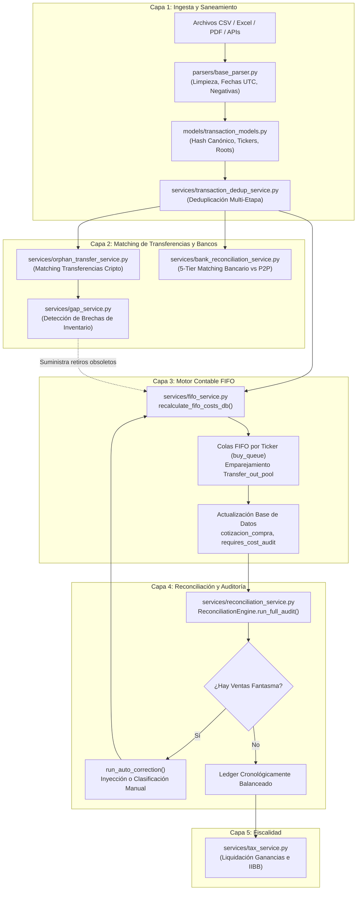
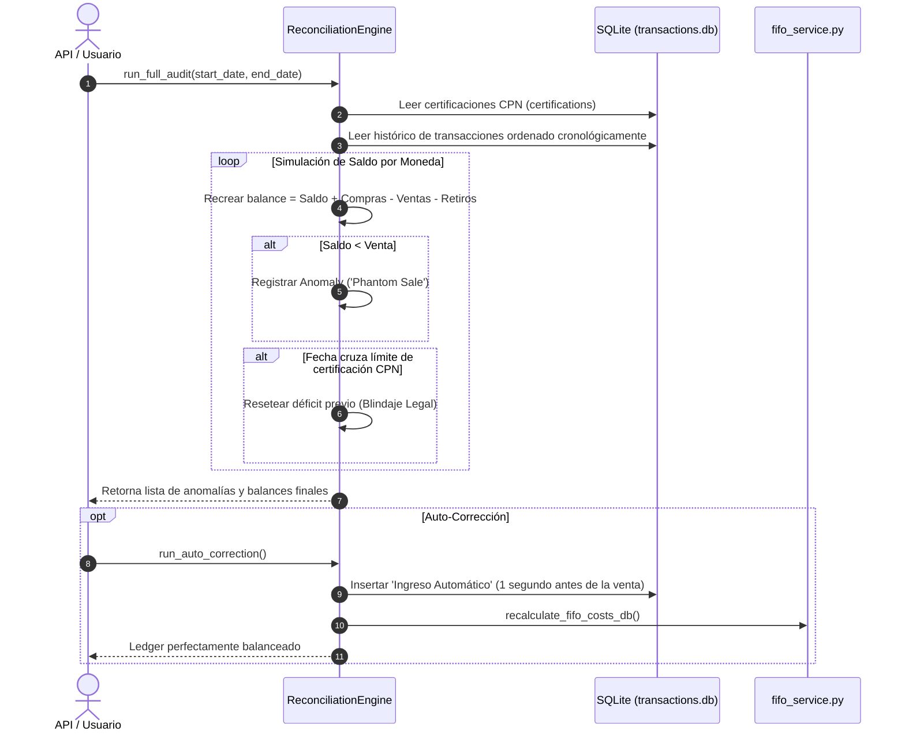
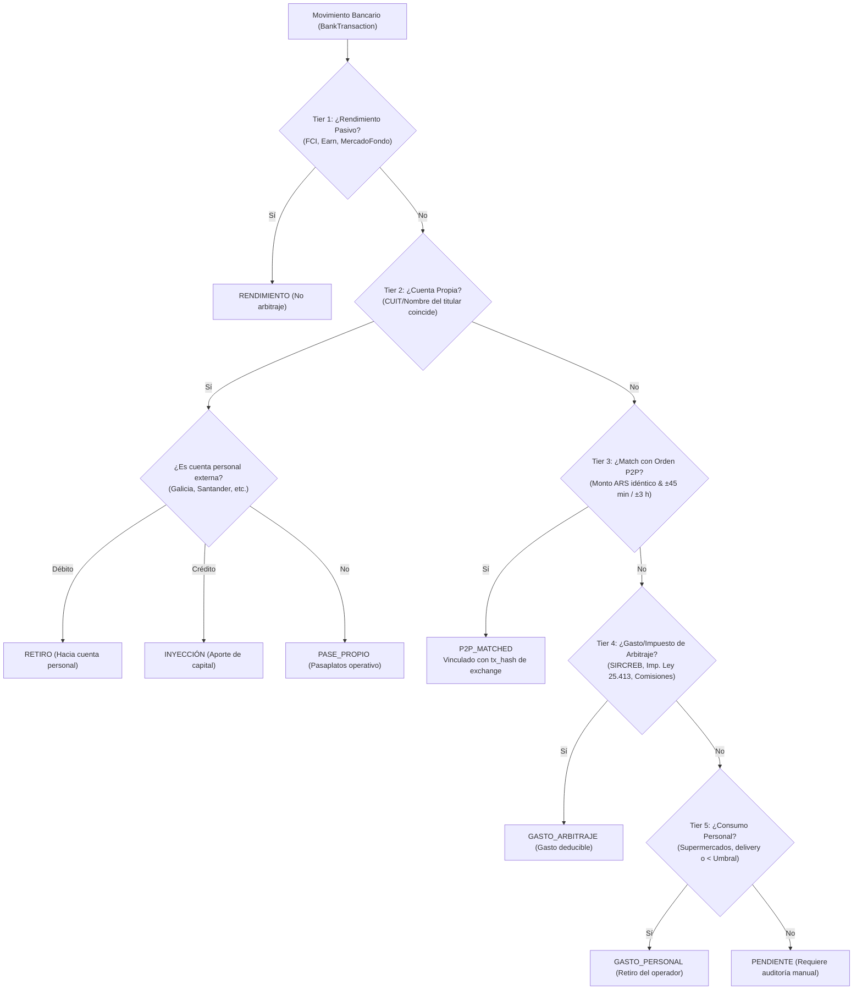

# Arquitectura y Documentación Técnica del Núcleo Lógico (Core)
## FIFO, Matching, Reconciliación Contable y Saneamiento de Datos

> **Audiencia:** Desarrolladores de software, ingenieros de datos y auditores de sistemas contables.  
> **Ubicación en el repositorio:** `docs/LOGICA_CORE_FIFO_MATCHING_SANEAMIENTO.md`  
> **Proyecto:** *CryptoTax Pro / Motor Programa Contable*

---

## 📑 Tabla de Contenidos

1. [Visión General del Dominio](#1-visión-general-del-dominio)
2. [Mapa Arquitectónico y Flujo de Control](#2-mapa-arquitectónico-y-flujo-de-control)
3. [Módulo 1: Motor FIFO de Costo Base (`fifo_service.py`)](#3-módulo-1-motor-fifo-de-costo-base-fifo_servicepy)
4. [Módulo 2: Auditoría de Ledger y Ventas Fantasma (`reconciliation_service.py`)](#4-módulo-2-auditoría-de-ledger-y-ventas-fantasma-reconciliation_servicepy)
5. [Módulo 3: Matching Bancario y Conciliación P2P (`bank_reconciliation_service.py`)](#5-módulo-3-matching-bancario-y-conciliación-p2p-bank_reconciliation_servicepy)
6. [Módulo 4: Transferencias Inter-Exchange y Detección de Brechas (`orphan_transfer_service.py` / `gap_service.py`)](#6-módulo-4-transferencias-inter-exchange-y-detección-de-brechas)
7. [Módulo 5: Motor de Saneamiento y Deduplicación (`transaction_dedup_service.py`)](#7-módulo-5-motor-de-saneamiento-y-deduplicación-transaction_dedup_servicepy)
8. [Módulo 6: Higienización y Normalización en Ingesta (`parsers/base_parser.py`)](#8-módulo-6-higienización-y-normalización-en-ingesta-parsersbase_parserpy)
9. [Módulo 7: Scripts de Reparación Forense Quirúrgica (`scripts/`)](#9-módulo-7-scripts-de-reparación-forense-quirúrgica-scripts)
10. [Matriz de Dependencias e Invocaciones Cruzadas](#10-matriz-de-dependencias-e-invocaciones-cruzadas)
11. [Reglas de Oro para Desarrolladores (Guardrails)](#11-reglas-de-oro-para-desarrolladores-guardrails)

---

## 1. Visión General del Dominio

En un ecosistema multi-exchange (Binance, Bitso, Fiwind, Ripio, OKX, Bybit, Lemon, etc.) combinado con arbitraje bancario fiat (Mercado Pago, bancos locales), la contabilidad enfrenta cuatro problemas críticos:
1. **Dispersión y Desorden Temporal:** Las operaciones ingresan en lotes desordenados, con husos horarios dispares (UTC vs ART) y formatos de fecha heterogéneos.
2. **Transferencias Inter-Exchange:** Un retiro de USDT en Binance seguido de un depósito en Bitso no es una venta ni una compra gravada; es un **traslado de inventario**. Si no se emparejan, el sistema creerá que hubo una venta sin costo o una compra con costo duplicado.
3. **Ventas Fantasma (Phantom Sales):** Vender un activo sin contar con compras registradas previamente en la cadena cronológica genera un saldo negativo ficticio o un costo base $0 inauditable.
4. **Duplicación Semántica:** Un usuario puede subir dos veces el mismo reporte, o reportes con distinta granularidad (órdenes consolidadas vs ejecuciones parciales / *fills*).

Para resolver esto, el **Núcleo Lógico (Core)** implementa una pipeline determinista de cinco capas:

```
[ Ingesta / Parsers ]
        │
        ▼ (Saneamiento y Normalización inicial)
[ Base Parser & Deduplicación Forense ]
        │
        ▼ (Asignación de transferencias internas)
[ Matching Inter-Exchange & Detección de Huérfanos ]
        │
        ▼ (Asignación de costo unitario por capas temporales)
[ Motor FIFO Global Multi-Moneda ]
        │
        ▼ (Auditoría cronológica y matching fiat)
[ Reconciliación Ledger & Matching Bancario P2P ]
        │
        ▼
[ Reporte Impositivo y Certificación C.P.N. ]
```

---

## 2. Mapa Arquitectónico y Flujo de Control



---

## 3. Módulo 1: Motor FIFO de Costo Base (`fifo_service.py`)

* **Ubicación:** `webapp/backend/services/fifo_service.py`
* **Fachada de compatibilidad:** `webapp/backend/compat/fifo_engine.py`

### Propósito del Módulo
Calcula y asigna el **costo base en ARS** a cada venta de criptomonedas siguiendo el método **Primero en Entrar, Primero en Salir (FIFO)**. Trabaja a nivel global de cartera por criptoactivo, permitiendo que compras hechas en un exchange (ej. Binance) cubran ventas realizadas en otro (ej. Fiwind) tras un traspaso.

### Imports Clave y por qué se utilizan
| Import | Motivo de Uso |
| :--- | :--- |
| `import collections` | Utiliza `collections.deque` para las estructuras `buy_queue` y `transfer_out_pool`. Ofrece complejidad $O(1)$ en operaciones `popleft()` y `append()`. |
| `import pandas as pd` | Ingesta masiva desde SQLite, ordenamiento vectorizado multidimensional y filtrado por series. |
| `from db.connection import get_connection` | Conexión directa transaccional con SQLite con soporte WAL y control de timeouts. |
| `from models.transaction_models import canonicalize_ticker, get_canonical_exchange_root, extract_transfer_txid, CRYPTO_DUST_EPSILON` | Normalización de símbolos (ej. `XBT` $\rightarrow$ `BTC`), unificación de subcuentas a exchanges raíz, extracción regex de hashes en comentarios y manejo de tolerancia a polvo flotante ($10^{-8}$). |
| `from services.gap_service import _egress_stale_withdrawals` | Drena retiros en tránsito que nunca tuvieron un depósito destino asociado tras 30 días, evitando que el saldo quede artificialmente inflado. |
| `from models.operational_models import OPERATIONAL_NON_TAXABLE_TYPES` | Excluye de FIFO operaciones neutras (pases internos, préstamos, swaps técnicos no gravables). |

### Funciones Principales

#### 1. `parse_date_robust(val)` y `parse_dates_series_robust(series)`
* **Qué hace:** Convierte cualquier representación de fecha (timestamps Unix en ms o segundos, formatos ISO `YYYY-MM-DD`, formatos latinoamericanos `DD/MM/YYYY hh:mm:ss`, con o sin zona horaria) en un objeto estándar `pd.Timestamp` o `Series[datetime64[ns]]` normalizado a **UTC sin zona horaria ingenua**.
* **Por qué:** Un error de formato en una sola fila invertiría el orden cronológico de una compra y una venta del mismo día, rompiendo la cola FIFO.

#### 2. `_get_op_priority(row)`
* **Qué hace:** Asigna una prioridad numérica de desempate intra-segundo:
  * Prioridad 1: **Compras e Inflows** (`COMPRA`, `BUY`).
  * Prioridad 2: **Retiros/Envíos** (`RETIRO`, `WITHDRAW`).
  * Prioridad 3: **Depósitos/Recepciones** (`INGRESO`, `DEPOSIT`).
  * Prioridad 4: **Comisiones/Fees** (`COMISION`, `FEE`).
  * Prioridad 5: **Ventas y Egresos** (`VENTA`, `SELL`).
* **Por qué:** Si una compra y una venta ocurren exactamente en el mismo segundo o con marcas de tiempo truncadas a la medianoche (`00:00:00`), la compra **debe ejecutarse antes** para que la venta tenga inventario disponible para consumir.

#### 3. `recalculate_fifo_costs_db()`
* **Qué hace:**
  1. Extrae todas las transacciones ordenadas por `fecha ASC, inflow_priority ASC, tx_hash ASC`.
  2. Itera moneda por moneda (`USDT`, `BTC`, `ETH`, etc.), descartando monedas fiat (`ARS`, `USD`, `EUR`).
  3. Mantiene dos deques en memoria:
     * `buy_queue`: Lotes de compras con `{'fecha', 'dt', 'qty_remaining', 'price_ars', 'exchange'}`.
     * `transfer_out_pool`: Retiros inter-exchange pendientes de emparejamiento.
  4. **Emparejamiento de Transferencias de 2 Niveles:**
     * *Nivel 1:* Match exacto por TXID de blockchain entre diferentes exchanges.
     * *Nivel 2:* Coincidencia dentro de una ventana de tiempo estricta ($-24\text{ h}$ a $+72\text{ h}$) y con tolerancia de comisiones de red ($\le 5\%$ o $\le 5\text{ USDT}$ en stablecoins). La diferencia por comisión de red consume saldo automáticamente de la `buy_queue`.
  5. **Consumo de Ventas:**
     * Desencola compras más antiguas de `buy_queue`.
     * Distingue entre lotes valuados (`price_ars > 0`) y lotes no valuados (`$0.0` producto de ingresos externos sin comprobante).
     * Calcula la cotización efectiva ponderada:
       $$\text{cotizacion\_compra\_fifo} = \frac{\sum (\text{cantidad\_usada}_i \times \text{precio\_ars}_i)}{\sum \text{cantidad\_usada\_valuada}_i}$$
     * Si la venta supera el inventario disponible, el excedente queda marcado en `monto_descubierto` y se activa la bandera `requires_cost_audit = 1`.
  6. **Blindaje de Certificaciones C.P.N.:**
     * Ejecuta la actualización en SQLite mediante `UPDATE transactions ... WHERE tx_hash = ? AND (is_certified IS NULL OR is_certified = 0)`.
     * Las filas selladas por auditoría profesional (`is_certified = 1`) son **inmutables**.

---

## 4. Módulo 2: Auditoría de Ledger y Ventas Fantasma (`reconciliation_service.py`)

* **Ubicación:** `webapp/backend/services/reconciliation_service.py`
* **Fachada de compatibilidad:** `webapp/backend/compat/reconciliation.py`

### Propósito del Módulo
Audita matemáticamente la integridad del balance cronológico de la cartera. Detecta **Ventas Fantasma (Phantom Sales)** (situaciones en las que se vendió criptomoneda que no existía en el ledger contable) y proporciona mecanismos tanto automáticos como asistidos para balancear los saldos.



### Funciones Principales

#### 1. `run_full_audit(start_date=None, end_date=None)`
* **Qué hace:**
  * Reconstruye el balance cripto segundo a segundo.
  * Respeta las certificaciones CPN previas: las fechas cubiertas por un dictamen sellado resetean cualquier déficit heredado (`ledgers[crypto] = max(0.0, ledgers[crypto])`), impidiendo que un error pasado contamine períodos ya firmados.
  * Detecta ventas no cubiertas por compras previas con una tolerancia a polvo $\varepsilon = 10^{-9}$.
  * Devuelve una lista detallada con: criptomoneda, fecha, monto faltante (`missing`), exchange origen y mensaje forense.

#### 2. `run_auto_correction()`
* **Qué hace:** Toma las anomalías de `run_full_audit()` y genera transacciones compensatorias automáticas bajo el exchange `"Sistema de Conciliación"` con tipo `"Ingreso Automático"`.
* **Detalle técnico crucial:** La fecha del ajuste se estampa **exactamente un segundo antes** (`fixed_date = anomaly_dt - timedelta(seconds=1)`) de la venta conflictiva. Esto garantiza que al reejecutar el motor FIFO, el saldo positivo exista en el microinstante previo a la venta.

#### 3. `classify_single_anomaly(...)`
* **Qué hace:** Permite al contador o usuario asignar manualmente el origen del saldo faltante:
  * `"Capital Inicial / Años Anteriores"` (costo $0 o costo histórico).
  * `"Exchange Externo"` o `"P2P / Efectivo"`.
* **Interacción:** Llama a `models.transaction_models.get_quote_usd_value()` y a `parsers.base_parser.get_usd_ars_rate()` para valuar el ingreso al tipo de cambio oficial/paralelo del día exacto del hecho imponible.

#### 4. `prune_obsolete_auto_corrections(coins=None, auto_re_correct=False)`
* **Qué hace:** Si un usuario sube tardíamente un extracto de compras reales de 2024, esta función elimina los `"Ingreso Automático"` sintéticos que se habían creado como parches temporales, reemplazándolos con los datos fehacientes recién importados.

---

## 5. Módulo 3: Matching Bancario y Conciliación P2P (`bank_reconciliation_service.py`)

* **Ubicación:** `webapp/backend/services/bank_reconciliation_service.py`
* **Modelos involucrados:** `models/operational_models.py` (`BankTransaction`)

### Propósito del Módulo
Cruza los extractos bancarios en ARS (bancos tradicionales y billeteras virtuales) con las transacciones de compra/venta de criptomonedas P2P registradas en los exchanges, catalogando ingresos, gastos deducibles y retiros personales.

### Algoritmo de Conciliación en 5 Niveles (5-Tier Matching)



### Funciones Principales

#### 1. `_parse_to_arg_tz(val, assume_utc=False)`
* **Qué hace:** Convierte fechas bancarias o de exchange a hora local argentina (`America/Argentina/Buenos_Aires`, UTC-3).
* **Por qué:** Los bancos argentinos emiten extractos en hora local, mientras que Binance y Bybit registran en UTC. Si no se alinean las zonas horarias, el matching de 45 minutos fallaría sistemáticamente por un desfasaje de 3 horas.

#### 2. `reconcile_bank_movements(bank_txs, ...)`
* **Entradas:** Lista de objetos `BankTransaction` del extracto, lista de nombres y CUITs del titular, palabras clave de cuentas operativas y cuentas personales.
* **Procesamiento:** Ejecuta los 5 Tiers explicados en el diagrama anterior.
* **Salidas:** Diccionario con:
  * `matched`: Transacciones bancarias resueltas con su categoría asignada y referencia al `tx_hash` de la orden cripto.
  * `pending`: Movimientos atípicos o huérfanos que requieren revisión contable.
  * `summary`: Tasa de conciliación porcentual y desglose por categorías.

---

## 6. Módulo 4: Transferencias Inter-Exchange y Detección de Brechas

* **Ubicaciones:**
  * `webapp/backend/services/orphan_transfer_service.py`
  * `webapp/backend/services/gap_service.py`
  * `webapp/backend/services/gap_enrichment_service.py`

### Propósito de los Módulos
1. **Detección de Retiros Huérfanos:** Encuentra retiros cripto de un exchange que nunca llegaron a otro exchange de la base de datos (posibles retiros a billeteras frías, pagos a terceros o extractos faltantes).
2. **Detección de Brechas Históricas (Gaps):** Localiza el momento exacto en que una cuenta entra en saldo negativo y busca pistas (*clues*) en otros exchanges para proponer una reconciliación automática.

### Funciones Principales en `orphan_transfer_service.py`

#### `detect_orphan_withdrawals(all_tx_df, ...)`
* **A quién llama:**
  * `models.transaction_models.get_canonical_exchange_root`
  * `models.transaction_models.extract_transfer_txid`
  * `services.monthly_custody_service._is_cold_storage_transfer`
* **Mecánica:**
  * Separa todos los egresos (`RETIRO`, `WITHDRAW`) de todos los ingresos (`DEPOSITO`, `DEPOSIT`).
  * Indexa los depósitos por su hash de blockchain (`txid`) y por moneda.
  * Si un retiro posee un TXID idéntico a un depósito en otro exchange dentro de una ventana de tiempo razonable, se descarta como huérfano.
  * Los retiros que no encuentran contraparte se contrastan contra la antigüedad del extracto (`freshness`): si el exchange destino no tiene extractos cargados para esa fecha, se alerta al usuario indicando el archivo exacto que falta subir.

### Funciones Principales en `gap_service.py` y `gap_enrichment_service.py`

#### `check_history_gaps(exchanges=None, mode='global', year=None)`
* Simula el inventario por exchange individual o a nivel consolidado global.
* Detecta el instante en que el stock acumulado de una moneda cae por debajo de cero.
* Devuelve el lote de déficits con su tamaño y fecha exacta.

#### `enrich_gaps_with_clues(gaps, ...)`
* Para cada déficit, explora transferencias salientes en otros exchanges ocurridas hasta 30 días antes con importes equivalentes ($\pm 5\%$).
* Sugiere acciones recomendadas al usuario: *"Se detectó un retiro de 500 USDT en Lemon Cash el día previo; cargue el extracto de Lemon para saldar este descubierto"*.

---

## 7. Módulo 5: Motor de Saneamiento y Deduplicación (`transaction_dedup_service.py`)

* **Ubicación:** `webapp/backend/services/transaction_dedup_service.py`

### Propósito del Módulo
Limpia la base de datos eliminando colisiones, reingestas accidentales y desajustes de granularidad (ej. cuando se sube el reporte resumido mensual y también el historial detallado de trades).

### Estrategia de Deduplicación en Múltiples Fases

```
[ Tabla transactions completa ]
               │
               ▼
   [ Fase 0: Filas Vacías ] ──> Elimina registros con montos en 0 que no sean certificaciones.
               │
               ▼
   [ Fase 1A: Por Order ID ] ──> Mismo (exchange, order_id, moneda, tipo, montos, fecha).
               │
               ▼
   [ Fase 1-Grupo: Granularidad ] ──> Conflicto Fills vs Consolidada. Si la suma de las
                                      ejecuciones parciales equivale a la orden padre,
                                      elimina la consolidada o los fills según certificación.
               │
               ▼
   [ Fase 2: Hash Canónico ] ──> Mismo hash SHA-256 determinista de evento físico.
               │
               ▼
   [ Fase 3: Semántica Física ] ──> Mismo evento material (fecha, moneda, montos redondeados).
               │
               ▼
   [ Filtro de Blindaje C.P.N. ] ──> RESTA todas las filas con is_certified = 1.
               │
               ▼
   [ DELETE en SQLite (Lotes de 500) ]
```

### Funciones Principales

#### `deduplicate_existing_database(conn=None)`
* **Imports clave:**
  * `from models.transaction_models import compute_canonical_tx_hash, canonicalize_ticker, get_canonical_exchange_root`
* **Mecánica destacada:**
  * `extract_clean_ref(ref)` y `extract_trade_id(ref)`: Usan expresiones regulares avanzadas para depurar números de orden ocultos en cadenas de comentarios ruidosas (ej. `"Trade ID: 84930219 - Fee 0.1 USDT"` $\rightarrow$ `84930219`).
  * **Protección de Certificaciones:**
    ```python
    all_certified_hashes = set(df[df['is_certified_temp'] == 1]['tx_hash'].dropna().tolist())
    hashes_to_delete = (hashes_to_delete - all_certified_hashes)
    ```
    Bajo ninguna circunstancia el script borrará una transacción que haya sido certificada por un Contador Público.

---

## 8. Módulo 6: Higienización y Normalización en Ingesta (`parsers/base_parser.py`)

* **Ubicación:** `webapp/backend/parsers/base_parser.py`

### Propósito del Módulo
Constituye la primera línea de defensa del sistema. Recibe los datos crudos extraídos de archivos subidos por el usuario (archivos Excel de Binance, CSV de Ripio, resúmenes en PDF escaneados o tablas OCR) y los higieniza antes de que toquen la base de datos o los servicios de dominio.

### Catálogo de Funciones de Saneamiento

| Función | Responsabilidad | Ejemplo de Transformación |
| :--- | :--- | :--- |
| `_normalize_text(s)` | Elimina acentos, marcas diacríticas, caracteres BOM (`\ufeff`), pasa a minúsculas y reemplaza guiones por espacios. | `"Depósito en Cta - U$S"` $\rightarrow$ `"deposito en cta   u$s"` |
| `is_cancelled_transaction(row)` | Evalúa mediante expresiones regulares (`_NEGATIVE_STATUS_REGEX`) si la operación fracasó, fue devuelta o rechazada. | Registros con estados `"Canceled"`, `"Fallido"`, `"Rechazada"`, `"Expired"` son descartados de inmediato. |
| `clean_decimal(val)` | Resuelve la ambigüedad entre puntos y comas decimales según convención anglosajona o europea/latina. | `"1.250,50"` $\rightarrow$ `1250.50` / `"$ 45.000"` $\rightarrow$ `45000.0` |
| `limpiar_numero_binance(valor)` | Sanea números con notación científica y limpia caracteres espurios de exportaciones de Binance. | `"1.234E-4"` $\rightarrow$ `0.0001234` |
| `normalize_exchange_name(ex_name)` | Unifica variantes de un mismo exchange a una denominación canónica. | `"Binance C2C"`, `"Binance Pay"`, `"Binance Spot"` $\rightarrow$ Submarcas identificadas bajo el exchange raíz `Binance`. |
| `parse_date(date_str, exchange)` | Aplica reglas heurísticas de fecha específicas del exchange y normaliza a **UTC**. | Si Bitso reporta en formato ISO y Lemon en hora local, ambas terminan en UTC estandarizado. |
| `create_transaction(...)` | Constructor canónico que valida tipos y campos obligatorios antes de generar un diccionario apto para persistencia. | Asegura que `monto_compra_cripto` y `monto_venta_cripto` nunca sean `None` sino `float(0.0)`. |

---

## 9. Módulo 7: Scripts de Reparación Forense Quirúrgica (`scripts/`)

En situaciones de mantenimiento extraordinario o migraciones de base de datos históricas, se utilizan scripts CLI dedicados que consumen directamente las funciones de los servicios descriptos:

* **[scripts/heal_database_and_deduplicate.py](../scripts/heal_database_and_deduplicate.py):**
  * Elimina registros mal mapeados (ej. órdenes de OKX erróneamente guardadas como Binance P2P).
  * Deduplica triplicados históricos de Bitso.
  * Dispara automáticamente `recalculate_fifo_costs_db()` e invalida la caché de analítica (`invalidate_analytics_cache()`).
* **[scripts/heal_binance_p2p_divergences.py](../scripts/heal_binance_p2p_divergences.py):**
  * Repara desajustes entre montos fiat y montos cripto en transacciones Binance P2P con split de comisiones.
* **[scripts/verify_fifo_cli.py](../scripts/verify_fifo_cli.py):**
  * Entorno de prueba unitario y de stress que monta una base SQLite temporal en memoria (`tempfile.NamedTemporaryFile`), inyecta compras y ventas escalonadas y valida que los costos asignados coincidan con el resultado manual esperado.
* **[scripts/enforce_clean_roots.py](../scripts/enforce_clean_roots.py):**
  * Auditoría de gobernanza que impide la colocación de scripts no autorizados o tests en la raíz del proyecto.

---

## 10. Matriz de Dependencias e Invocaciones Cruzadas

La siguiente tabla resume quién llama a quién y con qué objetivo dentro del ecosistema:

| Módulo Origen | Función / Componente | Módulo Destino Invocado | Función / Recurso Llamado | Motivo de la Invocación |
| :--- | :--- | :--- | :--- | :--- |
| `routes/transactions_bp.py` | Importación de archivos | `parsers/dispatcher.py` | `process_file()` | Interpreta y parsea el archivo subido. |
| `parsers/dispatcher.py` | Normalización de filas | `parsers/base_parser.py` | `clean_decimal()`, `parse_date()` | Higieniza tipos de datos y fechas a UTC. |
| `routes/transactions_bp.py` | Post-ingesta de datos | `services/transaction_dedup_service.py` | `deduplicate_existing_database()` | Purga duplicados recién insertados. |
| `routes/transactions_bp.py` | Post-deduplicación | `services/fifo_service.py` | `recalculate_fifo_costs_db()` | Recomputa costos unitarios de ventas. |
| `services/fifo_service.py` | Agrupación y colas | `models/transaction_models.py` | `canonicalize_ticker()`, `extract_transfer_txid()` | Agrupa por criptomoneda y extrae hashes para matching. |
| `services/fifo_service.py` | Egresos de retiros | `services/gap_service.py` | `_egress_stale_withdrawals()` | Consume retiros huérfanos con más de 30 días de antigüedad. |
| `routes/reconciliation_bp.py` | Solicitud de auditoría | `services/reconciliation_service.py` | `ReconciliationEngine.run_full_audit()` | Simula el ledger y detecta ventas fantasma. |
| `services/reconciliation_service.py` | Auto-corrección | `models/transaction_models.py` | `TransactionModel` | Construye el registro de ajuste para subsanar el déficit. |
| `services/reconciliation_service.py` | Clasificación manual | `services/tax_service.py` / `parsers/base_parser.py` | `get_usd_ars_rate()` | Obtiene la cotización cambiaria de la fecha para el ajuste. |
| `routes/reconciliation_bp.py` | Matching bancario | `services/bank_reconciliation_service.py` | `reconcile_bank_movements()` | Aplica el algoritmo de 5 niveles sobre el extracto bancario. |
| `services/bank_reconciliation_service.py` | Comparación de horas | `services/bank_reconciliation_service.py` | `_parse_to_arg_tz()` | Convierte fechas UTC y locales a hora argentina (ART). |

---

## 11. Reglas de Oro para Desarrolladores (Guardrails)

Si vas a modificar o extender el código de este núcleo, debes respetar estrictamente estas directivas:

1. **Inviolabilidad de Transacciones Certificadas (`is_certified == 1`):**
   * Cualquier transacción marcada con `is_certified = 1` representa un balance contable auditado legalmente ante AFIP o un organismo de control por un Contador Público.
   * **Nunca** actualices su `cotizacion_compra`, **nunca** la elimines en un proceso de deduplicación y **nunca** asumas que su saldo puede modificarse retroactivamente.
2. **Idempotencia de FIFO:**
   * La función `recalculate_fifo_costs_db()` debe ser completamente **idempotente**. Ejecutarla 1 vez o 10 veces seguidas sobre la misma base de datos debe arrojar exactamente el mismo resultado numérico y estado contable.
3. **Consistencia de Husos Horarios:**
   * En la base de datos `transactions.db`, **todas las fechas de transacciones de exchange deben estar en formato UTC estandarizado**.
   * La conversión a hora local argentina (`America/Argentina/Buenos_Aires`) está reservada exclusivamente para el cruce con extractos bancarios en `bank_reconciliation_service.py` o para la presentación en el frontend.
4. **Manejo de Polvo Flotante ($\text{Dust Epsilon}$):**
   * Debido a la imprecisión de punto flotante en cálculos binarios de Python (ej. `0.1 + 0.2 != 0.3`), nunca compares saldos cripto usando `== 0.0`. Utiliza siempre `CRYPTO_DUST_EPSILON` ($10^{-8}$) o `epsilon = 1e-9`.
5. **Límite de Líneas y Arquitectura Limpia:**
   * De acuerdo con la directiva arquitectónica del proyecto, **ningún archivo de servicio debe superar las 450-500 líneas de código**. Si agregas nueva lógica compleja, extiéndela en submódulos dentro de `services/` y expón una fachada limpia.
6. **Validación Automática Obligatoria:**
   * Antes de fusionar cambios en el núcleo, corre siempre la suite de pruebas del backend:
     ```bash
     pytest webapp/backend/tests/ -v
     python scripts/enforce_clean_roots.py
     ```
