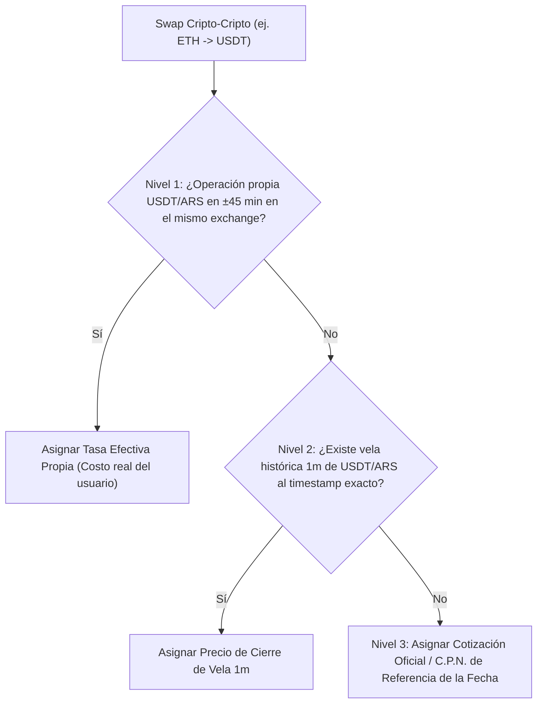

# Especificación del Motor FIFO y Matriz Única de Prioridades
### Algoritmo Determinista de Asignación de Costo Base e Invariantes de Inventario

> **Ubicación:** `docs/especificacion_fifo_prioridades.md`  
> **Referencia Metodológica:** Paso 3: Diagramación de Lógica y Flujos de Estado  
> **Proyecto:** *CryptoTax Pro / Motor Programa Contable*

---

## 1. Propósito y Modelo Teórico

El costeo de criptoactivos en la República Argentina sigue el principio legal y contable de **Primero en Entrar, Primero en Salir (FIFO)** a nivel de cartera consolidada:
* La primera unidad de un criptoactivo adquirida es la primera unidad computada como costo de venta al momento de una enajenación.
* Las compras efectuadas en un exchange (ej. Binance) transfieren válidamente su costo base a ventas efectuadas en otro exchange (ej. Fiwind) tras una transferencia inter-exchange.

---

## 2. Matriz Única de Prelación Intra-Segundo (`get_operation_priority`)

Cuando dos o más operaciones comparten el mismo segundo cronológico (o marcas de tiempo truncadas a la medianoche `00:00:00`), se aplica obligatoriamente la siguiente **matriz jerárquica de 5 niveles**:

```text
Prioridad 1: COMPRAS E INGRESOS DIRECTOS   (COMPRA, BUY)
Prioridad 2: RETIROS INTER-EXCHANGE       (RETIRO, WITHDRAW)
Prioridad 3: DEPÓSITOS INTER-EXCHANGE     (INGRESO, DEPOSIT)
Prioridad 4: COMISIONES / FEES            (FEE, TAX, GASTO)
Prioridad 5: VENTAS Y ENAJENACIONES       (VENTA, SELL)
```

### Tabla Formal de Prioridades

| Prioridad | Categoría | Direcciones Económicas | Razón de la Prelación |
| :---: | :--- | :--- | :--- |
| **1** | **Adquisición / Inflow** | `COMPRA`, `BUY`, Inyecciones de capital | Debe existir saldo en inventario antes de cualquier consumo posterior. |
| **2** | **Salida Inter-Exchange** | `RETIRO`, `WITHDRAW`, `EGRESO` | Registra la salida física del exchange emisor hacia el pool en tránsito. |
| **3** | **Entrada Inter-Exchange**| `DEPOSITO`, `DEPOSIT`, `INGRESO` | Registra la recepción en destino y empareja con el retiro en tránsito. |
| **4** | **Comisiones de Red** | `COMISION`, `FEE`, `TAX` | Consume saldo residual del lote para reflejar el gas/fee de blockchain. |
| **5** | **Enajenación Gravada** | `VENTA`, `SELL` | Consume las capas más antiguas de compras valuadas en ARS. |

---

## 3. Cascada de Valuación en Swaps Cripto-Cripto (3-Tier Waterfall)

Cuando se realiza un swap entre criptomonedas (ej. cambiar ETH por USDT) donde no interviene dinero fiat (ARS), el valor en ARS atribuible a la operación se determina mediante la siguiente **cascada determinista de tres niveles**:



1. **Nivel 1 (Tasa Efectiva Propia):** Si en la ventana de $\pm 45\text{ minutos}$ el usuario liquidó o compró la moneda puente (USDT) contra ARS, se adopta esa tasa real de cambio.
2. **Nivel 2 (Tick al Minuto):** En ausencia de orden propia, se consulta el precio de mercado de la vela de 1 minuto registrada para ese par en la base de datos o API histórica.
3. **Nivel 3 (Dictamen CPN):** Si la consulta falla o no hay conexión de red, se adopta la cotización de referencia certificada para la fecha (`cpa_seed_data.py`).

---

## 4. Reglas de Invariancia y Blindaje de Certificaciones

1. **Inmutabilidad de Filas Certificadas:**
   Cualquier registro con `is_certified == 1` no puede tener su `cotizacion_compra` modificada bajo ninguna circunstancia por el motor FIFO.
2. **Idempotencia:**
   $$\text{FIFO}(\text{Ledger}) \equiv \text{FIFO}(\text{FIFO}(\text{Ledger}))$$
   La ejecución reiterada del motor de costos sobre el mismo conjunto de datos produce idéntico resultado al bit.
3. **Manejo de Descubiertos (*Phantom Sales*):**
   Si una venta supera el inventario disponible de lotes de compra, el remanente se clasifica como `monto_descubierto > 0` y se marca con `requires_cost_audit = 1`, sin inventar costos de adquisición en cero.
